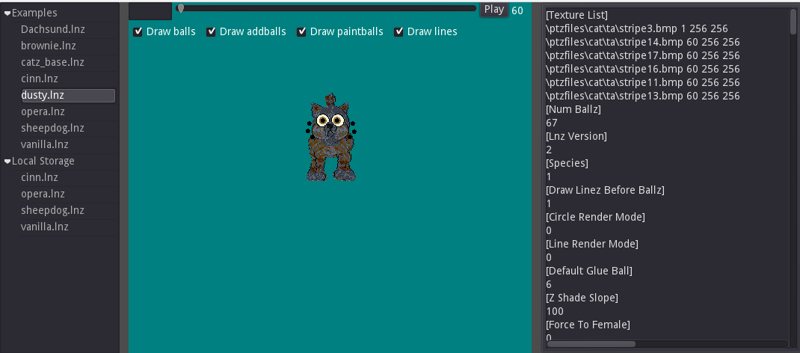

# LnzLive (Godot 4 Desktop Fork)



A desktop-focused fork of [mnemoli/LnzLive](https://github.com/mnemoli/LnzLive) — an interactive 3D previewer and editor for **Petz** `.lnz` files, migrated from **Godot 3** to **Godot 4**.

---

## Overview

**LnzLive** is a native desktop application that lets you load, inspect, edit, and preview Petz (`Catz` / `Dogz`) `.lnz` breed and pet files in real time, complete with ballz, addballz, linez, paintballz, palette shifting, textures, and `.bhd`/`.bdt` animation playback.

### Key Changes in This Fork

- **Desktop-First Application Scope** ([ADR-0001](doc/adr/0001-desktop-application-scope.md)):
  - Scoped specifically as a native desktop application rather than a browser-based web export, eliminating browser clipboard and local storage restrictions.
- **Godot 3 → Godot 4 Migration**:
  - Upgraded project configuration (`config_version=5`, `gl_compatibility` rendering backend) and scene/resource formats (`format=3`).
  - Migrated scripts to **GDScript 2.0** (`@export`, `@onready`, `Node3D` hierarchy, updated `ShaderMaterial.set_shader_parameter`, input handling, `DisplayServer.clipboard_set`, and `FileAccess`/`DirAccess` APIs).
  - Ported custom spatial shaders (`ball.tres`, `line.tres`, `paintball.tres`) to Godot 4's shader language (`INV_VIEW_MATRIX`, `ALPHA_SCISSOR_THRESHOLD`, Reverse-Z depth handling, sampler hints `filter_nearest` / `repeat_enable`, and `varying flat` interpolants).
  - Reorganized repository layout with the Godot project housed under [`src/`](src/) and architecture/feature documentation under [`doc/`](doc/).

---

## Project Structure

```text
├── doc/                  # Architecture Decision Records (ADRs), feature docs, and bug reports
│   └── adr/              # Architectural decisions (e.g., 0001-desktop-application-scope.md)
├── src/                  # Godot 4 project root
│   ├── data_classes/     # Parsers (.lnz, .bhd, .bdt) and data models
│   ├── resources/        # Example .lnz files, animations (.bhd/.bdt), palettes, and textures
│   ├── scenes/           # Main editor UI and 3D pet generator scenes/scripts
│   ├── scripts/          # 3D node scripts (Ball, Line, Paintball, camera rotation)
│   ├── shaders/          # Custom spatial shaders for Petz-style ball/line/paintball rendering
│   ├── GUIDE.md          # Detailed usage and tool guide
│   └── project.godot     # Godot 4 engine configuration
└── README.md
```

---

## Getting Started

1. **Install Godot 4**: Download [Godot Engine 4.x](https://godotengine.org/download/).
2. **Import the Project**:
   - Open the Godot Project Manager.
   - Click **Import** and select [`src/project.godot`](src/project.godot).
3. **Run**: Press **F5** (or click the Play button in the top-right corner of the editor) to launch the desktop application (`res://scenes/editor/editor.tscn`).

---

## Usage & Controls

For full instructions on editing `.lnz` files, keyboard shortcuts, local user storage, and built-in tools (Add Ball, Color Swap, Copy L to R, Move Head, etc.), see the [**Usage Guide (`src/GUIDE.md`)**](src/GUIDE.md).

### Quick Controls
- **Rotate Pet**: Left-click + drag in the 3D view
- **Pan View**: Right-click + drag
- **Zoom**: Mouse wheel
- **Save & Refresh Preview**: `Ctrl + S`
- **Tools Menu**: `Ctrl + Space` in the pet view
- **Highlight Ball from LNZ**: Place cursor on a line in `[Ballz Info]` or `[Add Ball]` and press `Ctrl + Q`

---

## Credits & References

- **Original Project**: [mnemoli/LnzLive](https://github.com/mnemoli/LnzLive) by [mnemoli](https://github.com/mnemoli)
- **Wiki & Documentation**: [LnzLive on Petz Wiki](https://petz.miraheze.org/wiki/LnzLive)
- **Shader & Line Drawing Reference**: [Ratshack Godot Line Drawing Notes](https://ratshack.neocities.org/text/godot/linedrawing)
