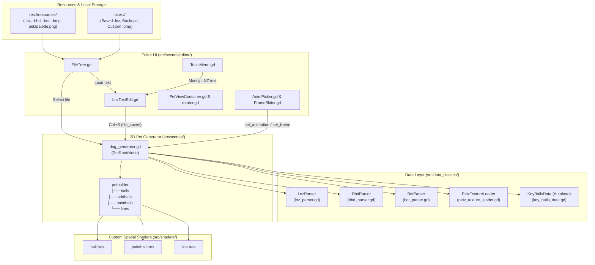

# System Architecture & 3D Rendering Pipeline

This document describes the internal architecture of **LnzLive**, how pet data flows from disk into the 3D scene tree, and how custom Godot 4 spatial shaders emulate the classic PF.Magic *Petz* renderer.

---

## 1. High-Level Architecture

---

## 2. Scene Tree Hierarchy (`editor.tscn`)

When [`editor.tscn`](../src/scenes/editor/editor.tscn) runs, the scene tree is organized into two primary branches under `Root`:

1. **`PetRoot` (`Node3D`)**:
   - `Node` ([`dog_generator.gd`](../src/scenes/dog_generator.gd)): Orchestrates parsing, skeletal pose evaluation, and node instantiation.
   - `petholder` (`Node3D`): Container for all generated 3D visual primitives:
     - `balls`: Base skeletal `Ball.tscn` instances (`0..66`), plus eye irises (`Paintball.tscn` instances).
     - `addballs`: Child `Ball.tscn` instances parented directly to their base ball nodes in `ball_map`.
     - `paintballs`: Child `Paintball.tscn` instances parented to their base ball or addball nodes.
     - `lines`: `Line.tscn` instances connecting pairs of balls/addballs.
2. **`SceneRoot` (`Control`)**:
   - `SubViewportContainer/SubViewport/CameraHolder/Camera3D`:
     - Uses an **Orthogonal** projection (`projection = 1`, `keep_aspect = KEEP_WIDTH`, `size = 2.0`, `near = 0.01`, `far = 1000.0`) inside a $1000 \times 1000$ viewport.
     - With `pixel_world_size = 0.002` and camera `size = 2.0` across a $1000\text{ px}$ viewport, **1 Petz coordinate unit equals 1 screen pixel** at default zoom ($1000 \times 0.002 = 2.0$).
   - `HSplitContainer`:
     - Left panel: `Tree` ([`FileTree.gd`](../src/scenes/editor/FileTree.gd)) listing `Examples`, `Local Storage` (`user://`), and `Local Textures` (`user://resources/textures`).
     - Center panel: `PetViewContainer` ([`PetViewContainer.gd`](../src/scenes/editor/PetViewContainer.gd)) overlaying the 3D viewport with the animation toolbar (`AnimPicker`, `FrameSlider`, `PlayButton`, `FPSLabel`) and visibility toggles (`Draw balls`, `Draw addballs`, `Draw paintballs`, `Draw lines`, `Select`).
     - Right panel: `LnzTextEdit` ([`LnzTextEdit.gd`](../src/scenes/editor/LnzTextEdit.gd)) providing live text editing, section-aware ball navigation, and automated hexing transformations.

---

## 3. The 7-Stage Pet Generation Pipeline

Whenever a pet is loaded (`generate_pet(file_path)`) or the animation frame changes (`set_frame(frame)`), [`dog_generator.gd`](../src/scenes/dog_generator.gd) executes a deterministic 7-stage pipeline:

### Stage 1: Base Skeletal Loading (`init_ball_data` & `collate_base_ball_data`)
- Reads species (`1 = CAT`, `2 = DOG`) from `LnzParser`.
- Parses `CAT.bhd` or `DOG.bhd` via [`BhdParser`](../src/data_classes/bhd_parser.gd) to obtain the base ball count (`67`), default base ball sizes, and frame offset table for `current_animation`.
- Parses `CAT<N>.bdt` or `DOG<N>.bdt` via [`BdtParser`](../src/data_classes/bdt_parser.gd) to obtain each base ball's 3D position and Euler rotation for `current_frame`.

### Stage 2: LNZ Ball Overrides & Moves (`munge_balls`)
- Merges `[Ballz Info]` overrides from the `.lnz` file into the base skeletal balls:
  - Adds the `.lnz` size modifier to the `.bhd` base ball size (`b.size += v.size`).
  - Copies `color_index`, `outline_color_index`, `outline`, `fuzz`, and `texture_id`.
- Applies all `[Move]` entries for each base ball:
  - Converts the reference ball's Euler rotation (`rot`, either the ball itself or `m.relative_to`) into a `Quaternion`.
  - Rotates the move offset vector `m.position` by `q` and adds it to the ball's position.

### Stage 3: Anatomical Extensions & Enlargements (`apply_extensions`)
Uses species-specific ball group tables from [`KeyBallsData`](../src/data_classes/key_balls_data.gd) to apply breed proportion modifiers:
- **Leg Extensions (`[Leg Extension]`)**: Adjusts `position.y` of front (`legs[0]`) and back (`legs[1]`) leg balls. Hip/shoulder anchor balls scale proportionally (`abs(y * ext / 100.0)`), while lower limb balls shift by `ext`.
- **Body Extension (`[Body Extension]`)**: Shifts posterior/hindquarter balls along `position.z` by `body_extension * 2` (and the mid-spine ball by `body_extension`).
- **Face Extension (`[Face Extension]`)**: Shifts snout/muzzle balls (`face_ext`) forward along `-Z` (`position.z -= face_extension`).
- **Head Enlargement (`[Head Enlargement]`)**: Scales the offset of all head balls relative to the central head ball by `head_enlargement.x / 100.0`, and modifies their sizes by `floor(size * (x / 100.0)) + y`.
- **Feet Enlargement (`[Feet Enlargement]`)**: Scales paw/toe ball sizes by `floor(size * (x / 100.0)) + y`.
- **Ear Extension (`[Ear Extension]`)**: Scales the vector from each ear base ball (`4`, `28` for dogs; `8`, `10` for cats) to its ear tip balls by `ear_extension / 100.0`.

### Stage 4: Global Scaling (`apply_sizes`)
Applies the two `[Default Scales]` values (`scales[0]` = body position scale, `scales[1]` = ball size scale, where `255` $\approx 100\%$):
- For every base ball and addball:
  $$\text{size}_{\text{raw}} = \text{round}\!\left((\text{size} - 2) \times \frac{\text{scales}[1]}{255.0}\right)$$
  $$\text{size}_{\text{final}} = \text{size}_{\text{raw}} - (1 - (\text{size}_{\text{raw}} \bmod 2))$$
  (ensuring odd integer pixel diameters for symmetric rasterization), and:
  $$\text{position}_{\text{final}} = \text{position} \times \frac{\text{scales}[0]}{255.0}$$

### Stage 5: 3D Node Instantiation (`generate_balls`)
- Converts Petz coordinates (where $+Y$ is down) to Godot 3D coordinates (where $+Y$ is up) by multiplying `y *= -1.0` and scaling by `pixel_world_size` (`0.002`).
- Computes `belly_position` (ball `2` for cats, ball `48` for dogs) as the pet's Z-shading reference center.
- **Base Balls**: Instantiates `Ball.tscn` for normal balls. Eye iris balls (`14, 38` for dogs; `27, 28` for cats) are instantiated as `Paintball.tscn` with `z_add = 10` clipped to their respective eyeball (`8, 32` for dogs; `14, 15` for cats).
- **Addballs**: Instantiates `Ball.tscn` as children of `ball_map[ball.base]`, so addballs automatically inherit the translation and rotation of their parent base ball, with `z_add = ball.size / 10.0`.
- **Paintballs**: Reverses the per-ball paintball array and instantiates `Paintball.tscn` as children of their parent ball (`ball_map[key]`), positioned at:
  $$\text{origin} = \text{normalised\_position} \odot (1, -1, 1) \times \frac{\text{base\_ball.size}}{2.0} \times \text{pixel\_world\_size}$$
  with incremental `z_add = count * 1.0`.

### Stage 6: Ball Projections (`apply_projections`)
- Processes `[Project Ball]` entries in order after node transforms are in the tree.
- Moves each projected ball along the world-space ray from `static_ball` (`base`) through `visual_ball` (`ball`):
  $$\text{pos}_{\text{new}} = \text{pos}_{\text{base}} + (\text{pos}_{\text{ball}} - \text{pos}_{\text{base}}) \times \frac{\text{amount}}{100.0}$$

### Stage 7: Line Generation (`generate_lines`)
- For each entry in `[Linez]` where neither endpoint is in `[Omissions]`:
  - Instantiates `Line.tscn` at the midpoint between `start.global_transform.origin` and `end.global_transform.origin`.
  - Orients the quad along the vector from midpoint to `target_pos` (`look_at_from_position` + $90^\circ$ X pitch) and scales its Y length to `distance`.
  - Passes both endpoint world positions (`ball_world_pos1`, `ball_world_pos2`), `belly_position`, `fuzz_amount`, and pixel thicknesses:
    $$\text{line\_widths} = (\text{start.ball\_size}, \text{end.ball\_size}) \odot \frac{(\text{s\_thick}, \text{e\_thick})}{100.0}$$

---

## 4. Custom Spatial Shaders (`src/shaders/`)

All three visual primitives use `shader_type spatial` with `render_mode unshaded, skip_vertex_transform` and alpha scissoring (`ALPHA_SCISSOR_THRESHOLD = 0.5`) to achieve crisp, unblurred pixel-art edges without anti-aliasing artifacts.

### 4.1 Ball Shader ([`ball.tres`](../src/shaders/ball.tres))
- **Vertex Stage**:
  - **Billboarding**: Constructs a camera-facing `MODELVIEW_MATRIX` using `VIEW_MATRIX * mat4(INV_VIEW_MATRIX[0], INV_VIEW_MATRIX[1], INV_VIEW_MATRIX[2], MODEL_MATRIX[3])`.
  - **Pixel Center Snapping**: Projects the ball's origin `(0, 0, 0)` to screen space and snaps `center_fragcoord = floor(center_ndc * VIEWPORT_SIZE) + 0.5` so every fragment measures distance to a discrete pixel center.
  - **Quad Sizing & Z-Offset**: Expands the quad vertices in view space to cover `ball_size / 2.0 + fuzz_amount + 3.5` pixels and adds `z_add * 0.001` to `vert_in_clip_space.z`.
- **Fragment Stage**:
  - **Fuzzing**: Computes a deterministic pseudo-random horizontal pixel offset per scanline:
    $$r = \lfloor (\text{random}(\text{FRAGCOORD}.y - c_y) \times 2.0 - 1.0) \times \text{fuzz\_amount} \rfloor$$
    and shifts `st.x += r`.
  - **Outlines**: Evaluates an outer circle mask `pct2` and inner fill circle mask `pct` based on the `outline` mode:
    - `-1`: No outline.
    - `0`: 1px left-side outline (`st2.x -= 1.0`).
    - `-2`: 1px right-side outline (`st2.x += 1.0`).
    - `1`: Dotted/broken side outline.
    - `-3`: Special nose highlight outline.
    - `> 1`: Full concentric outline of thickness `outline - 1` pixels.
  - **Palette & Texture Lookup**: Samples `ball_texture` (if `has_texture`) or `color_index` against the $256 \times 1$ `palette` texture (`petzpalette.png`), applying Z-depth shading when `transparent_index > 0`.

### 4.2 Paintball Shader ([`paintball.tres`](../src/shaders/paintball.tres))
- Identical to `ball.tres` in fuzzing, outlining, and palette lookup, with two critical additions:
  1. **Silhouette Clipping (`base_pct`)**: Projects the parent ball's `base_world_position` to `base_center_fragcoord` and computes `base_pct = step(length(st - b), float(base_ball_size) / 2.0)`. Both the paintball fill (`pct`) and outline (`pct2`) are multiplied by `base_pct`, clipping the paintball cleanly to the parent ball's circle.
  2. **Hemisphere Depth Clamping**: In the vertex shader, if the paintball lies on the front hemisphere of the parent ball (`vert_in_clip_space.z > base_center_clip_space.z`), its view-space Z is clamped to `base_center_clip_space.z + 0.001 + z_add * 0.001` so it renders just in front of the parent ball's billboard without poking through balls closer to the camera. Paintballs on the back hemisphere remain behind the parent ball billboard and are naturally occluded.

### 4.3 Line Shader ([`line.tres`](../src/shaders/line.tres))
- **Vertex Stage**:
  - Projects the line mesh's endpoints into Normalized Device Coordinates (NDC) and computes the 2D screen-space unit normal perpendicular to the line segment.
  - Extrudes each vertex left or right along the screen-space normal by `line_width_in_pixels_start` (at the start endpoint) or `line_width_in_pixels_end` (at the end endpoint), producing a tapered 2D trapezoid that connects the two balls smoothly.
  - **Reverse-Z Depth Ordering**: Projects both connected ball centers (`ball_world_pos1`, `ball_world_pos2`) into clip space and sets:
    $$z_{\text{pos}} = \min(z_{\text{ball1}}, z_{\text{ball2}}) - 10^{-6}$$
    In Godot 4's Reverse-Z clip space (where smaller $z$ is farther from the camera), this places the entire line segment just behind the farther of the two balls it connects, preventing the line from overlapping either endpoint ball.
- **Fragment Stage**:
  - Interpolates `scaled_uv_x` across the trapezoid's width (`0.25` to `0.75` active region), applies horizontal scanline fuzzing along `uv_to_flat`, draws 1px left/right outlines using `l_color_index` and `r_color_index` (when $\neq -1$), and fills the interior with the line's texture or palette color.
