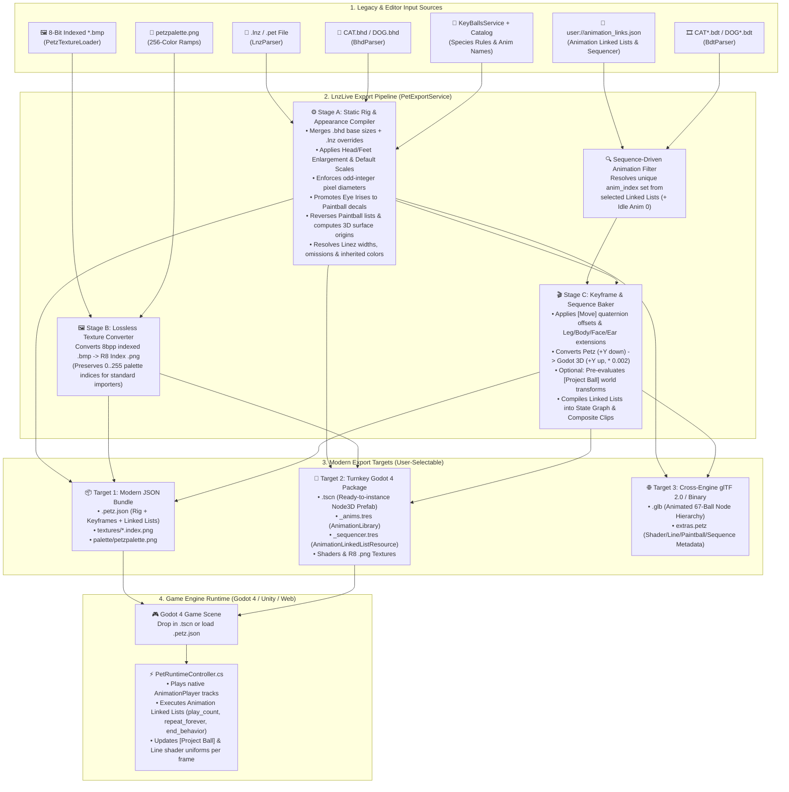
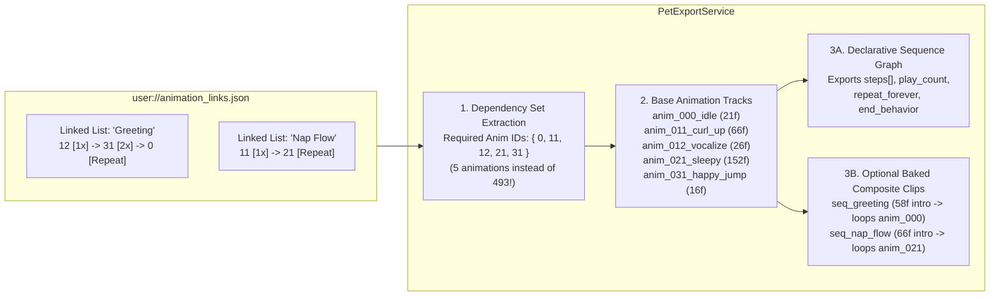

# Modern Pet Asset Export & Game Engine Pipeline

## 📖 Overview
Introduce a comprehensive **Pet Asset Export & Game Engine Pipeline** (`IPetExportService` / `ExportPetWindow`) that consolidates all legacy PF.Magic *Petz* data sources required to render and animate a Cat or Dog—`.lnz` breed/pet files (or `.pet` embedded data), `.bhd` skeletal headers, `.bdt` per-frame animation binaries, 8-bit indexed `.bmp` textures, `petzpalette.png` color ramps, species anatomical tables ([`KeyBallsService.cs`](../../../src/Services/KeyBallsService.cs)), and user-authored **Animation Linked Lists** ([`Animation-Linked-Lists-and-Sequencer.md`](Animation-Linked-Lists-and-Sequencer.md))—into modern, self-contained formats (**JSON Bundle `.petz.json`**, **Native Godot 4 `.tscn` + `AnimationLibrary.tres`**, and optional **glTF 2.0 `.glb`**).

Currently, rendering a single pet in [`DogGenerator.cs`](../../../src/Rendering/DogGenerator.cs) requires shipping nearly a thousand legacy binary `.bdt` files (`493` for Catz, `445` for Dogz), parsing loose INI-like `.lnz` text with regular expressions, decoding custom 8-bit Windows `.bmp` headers byte-by-byte to preserve palette indices, and re-running a 7-stage CPU munging pipeline (`MungeBalls`, `ApplyExtensions`, `ApplySizes`, `GenerateBalls`, `ApplyProjections`, `GenerateLines`) on every animation frame. By exporting pre-evaluated rig geometry, baked skeletal keyframes, lossless single-channel (`R8`) index PNG textures, and declarative **Animation Linked List** state graphs, game developers can import complete, ready-to-play Catz and Dogz characters directly into **Godot 4** (or any modern engine such as Unity, Unreal, or Web/Three.js) with **zero legacy file parsers**.

---

## 🎯 Goals & Use Cases
- **Goal 1 (Unify All 7 Render & Animation Data Sources):** Aggregate every piece of information that determines a Cat or Dog render—from `.lnz`, `.bhd`, `.bdt`, `.bmp`, and `petzpalette.png` to implicit engine rules in [`KeyBallsService.cs`](../../../src/Services/KeyBallsService.cs) and behavior chains in `user://animation_links.json`—into a single, versioned, strongly-typed schema.
- **Goal 2 (Eliminate Legacy Runtime Parsing & Per-Frame CPU Munging):** Pre-evaluate Petz-specific math during export (anatomical extensions, enlargements, `[Move]` quaternion offsets, odd-pixel diameter rounding, $+Y$-up coordinate conversion, eye-iris decal promotion, paintball back-to-front reversal, and 8-bit `.bmp` $\rightarrow$ lossless `.png` index conversion) while optionally retaining parametric metadata for runtime coat recoloring or proportion sliders.
- **Goal 3 (First-Class Integration with Animation Linked Lists & Sequencer):** Leverage the named sequences from [`Animation-Linked-Lists-and-Sequencer.md`](Animation-Linked-Lists-and-Sequencer.md) both to **prune unused animations** (exporting only the `.bdt` animations referenced by the pet's behavior chains plus Idle `Anim 0`, rather than all 445–493 files) and to **export ready-to-run behavior sequences** as declarative state graphs and/or composite `AnimationLibrary` clips.
- **Goal 4 (Turnkey Godot 4 & Cross-Engine Import):** Provide two primary export targets:
  1. **Engine-Agnostic Modern JSON Bundle (`.petz.json` + `.png` textures):** Clean, human-readable JSON schema loadable in Godot, Unity, Web, or custom tooling.
  2. **Native Godot 4 Turnkey Package (`.tscn` + `AnimationLibrary.tres` + `AnimationNodeStateMachine.tres`):** A drop-in 3D scene prefab with pre-wired `ShaderMaterial`s, a native Godot `AnimationPlayer` (stepped `Nearest` keyframe tracks), and a lightweight `PetRuntimeController.cs` script that plays exported Animation Linked Lists out of the box.
- **Use Case A (Importing a Pet into a Godot 4 Desktop Pet or RPG Game):** A developer hexes a custom cat in LnzLive, builds named behavior chains (`"Idle Loop"`, `"Walk Cycle"`, `"Backflip Combo to Idle"`, `"Sleep Transition"`) in the Animation Sequencer, and exports a **Godot 4 Package** (or **JSON Bundle**). They drop the exported folder into their game project and call `pet.PlaySequence("Backflip Combo to Idle")` without bundling `CAT0.bdt`–`CAT492.bdt` or `LnzParser`.
- **Use Case B (Lightweight Web / Cross-Engine Pet Viewer):** A creator exports a pet as a single `.petz.json` bundle with **Fully Baked Frame Transforms** enabled. A Three.js or 2D Canvas viewer renders the pet and its Animation Linked Lists directly from the pre-computed world-space ball/addball/paintball/line coordinates without implementing Petz skeletal hierarchy or `[Project Ball]` math.
- **Use Case C (Runtime Recoloring & Genetics in a Modern Game):** A game developer exports a base breed `.petz.json` with **Parametric Metadata** enabled. At runtime in Godot, the game swaps `color_index` values by `group` or shifts `[Leg Extension]` dynamically while still using pre-parsed JSON animations and `R8` `.png` textures.

---

## 👥 Target Audience / User Roles
- **Game Developers (Godot 4, Unity, Web):** Engineers building modern desktop pets, virtual worlds, or games who want to use Petz rigs and animations as native engine assets.
- **Desktop Pet Designers & Animators:** Creators using LnzLive and the **Animation Linked Lists & Sequencer** ([`Animation-Linked-Lists-and-Sequencer.md`](Animation-Linked-Lists-and-Sequencer.md)) to author high-level pet behaviors for export.
- **Petz Hexers & Preservationists:** Community members archiving custom breeds and adopted pets in open, self-documented JSON formats independent of 1990s binary layouts.

---

## 🗂️ Complete Inventory of Source Files Determining a Cat / Dog Render

To accurately reproduce a Cat or Dog render outside LnzLive, the export pipeline must extract and synthesize data from **seven distinct sources** (five external file formats and two internal/user data sources):

| # | Source File / Service | Current Parser / Class | Format Specification | Information Contributed to the Render | How the Export Pipeline Transforms It |
| :--- | :--- | :--- | :--- | :--- | :--- |
| **1** | **Breed / Pet Definition (`.lnz` or `.pet`)** | [`LnzParser.cs`](../../../src/Parsers/LnzParser.cs) | [`LNZ-Format.md`](../../formats/LNZ-Format.md)<br>[`PET-Format.md`](../../formats/PET-Format.md) | • `[Species]` (`1 = Cat`, `2 = Dog`)<br>• `[Default Scales]` (`bodyScale`, `ballSizeScale`)<br>• Anatomical extensions: `[Leg Extension]`, `[Body Extension]`, `[Face Extension]`, `[Ear Extension]`<br>• Enlargements: `[Head Enlargement]`, `[Feet Enlargement]`<br>• `[Omissions]`: Hidden base/addball IDs<br>• `[Ballz Info]`: 67 base ball size modifiers, palette colors, outline colors/modes, fuzz, group, texture IDs<br>• `[Add Ball]`: Parented spheres (`67..N`) with local XYZ offsets, absolute sizes, colors, outlines, fuzz, textures<br>• `[Move]`: Local XYZ offsets rotated by a reference ball's per-frame Euler rotation<br>• `[Project Ball]`: Ordered ray projections (`anchor -> target` by `amount%`)<br>• `[Linez]`: Tapered cylinders/quads connecting ball pairs (`start`, `end`, `s_thick%`, `e_thick%`, `fuzz`, `color`, `l_color`, `r_color`)<br>• `[Paint Ballz]`: Surface-normal decals (`base`, `size%`, normalized `xyz`, colors, outline, fuzz, texture, `anchored`)<br>• `[Texture List]`: `.bmp` filenames & `transparent_color` ramp modes | Parsed once and serialized into clean JSON objects (`rig.base_balls`, `rig.add_balls`, `rig.paintballs`, `rig.lines`, `rig.projections`), with all static size/scale math and omissions pre-resolved. |
| **2** | **Master Skeletal Header (`CAT.bhd`, `DOG.bhd`)** | [`BhdParser.cs`](../../../src/Parsers/BhdParser.cs) | [`BHD-and-BDT-Formats.md`](../../formats/BHD-and-BDT-Formats.md) | • Base skeletal ball count (`NumBalls = 67`)<br>• Unscaled default pixel diameter for each base ball (`BallSizes[0..66]`)<br>• Total animation count (`493` Cat, `445` Dog) and frame offset tables (`AnimationRanges`) | Combined with `.lnz` `[Ballz Info]`, `[Head/Feet Enlargement]`, and `[Default Scales]` to compute each base ball's final odd-integer pixel diameter (`size_final_px`). Binary offset tables are discarded after extracting frames. |
| **3** | **Per-Animation Frame Binaries (`CAT*.bdt`, `DOG*.bdt`)** | [`BdtParser.cs`](../../../src/Parsers/BdtParser.cs) | [`BHD-and-BDT-Formats.md`](../../formats/BHD-and-BDT-Formats.md)<br>[`Catz-Animations-Catalog.md`](../../formats/Catz-Animations-Catalog.md) | • Per-frame 14-byte header (`_spec[6]` bounds + `Tag`)<br>• Per-frame `67 × 10`-byte transforms: signed `int16` `(x, y, z)` positions in Petz pixel space ($+Y$ down) and signed `int8` Euler `(rotX, rotY, rotZ)` rotations in degrees | Combined with `.lnz` `[Move]`, anatomical extensions, `[Default Scales]`, and coordinate inversion ($Y \times -1 \times 0.002$) to output ready-to-use 3D keyframes in `animations` (or Godot `Animation` tracks). |
| **4** | **Species Anatomical & Special Rules** | [`KeyBallsService.cs`](../../../src/Services/KeyBallsService.cs) | [`Architecture-and-Rendering.md`](../../Architecture-and-Rendering.md) | **Implicit rules not present in `.lnz`/`.bhd`:**<br>• **Belly Z-Center Ball:** Ball `2` (Cat) or `48` (Dog) used as `z_center_pet` for Z-depth palette shading<br>• **Eye Iris Decals:** Base balls `27, 28` (Cat) or `14, 38` (Dog) must be rendered as `Paintball` decals (`z_add = 10`) clipped to parent eyeballs `14, 15` (Cat) or `8, 32` (Dog)<br>• **Anatomical Ball Groups:** `Legs`, `BodyExt`, `FaceExt`, `HeadExt`, `FootExt`, `EarExt`<br>• **Semantic Tags:** `Nose`, `Tail`, `Tongue`, and L/R symmetry maps | Explicitly embedded into the exported manifest (`belly_ball_no`, `render_as_iris_decal`, semantic tags, and pre-applied anatomical extensions) so importers need **no** hardcoded species tables. |
| **5** | **256-Color Master Palette (`petzpalette.png`)** | Shader uniform in [`ball.tres`](../../../src/shaders/ball.tres), [`paintball.tres`](../../../src/shaders/paintball.tres), [`line.tres`](../../../src/shaders/line.tres) | [`Palettes-and-BMP-Textures.md`](../../formats/Palettes-and-BMP-Textures.md)<br>[`Petz-Color-Palette.md`](../../formats/Petz-Color-Palette.md) | • 256 RGB colors (`0..255`)<br>• Fixed utility colors (`0..9`), 14 ten-shade coat/eye ramps (`10..149`) for Z-depth shading (`-1` near, `+2` far) and ramp shifting, non-shifting blocks (`150..255`) | Bundled as `palette/petzpalette.png` **and** exported as an explicit 256-entry RGB hex/array table in `.petz.json` with ramp-shift metadata. |
| **6** | **8-Bit Indexed Surface Textures (`*.bmp`)** | [`PetzTextureLoader.cs`](../../../src/Parsers/PetzTextureLoader.cs) | [`Palettes-and-BMP-Textures.md`](../../formats/Palettes-and-BMP-Textures.md) | • Uncompressed 8bpp indexed Windows bitmaps (`stripe3.bmp`, `plush.bmp`, etc.) where each byte (`0..255`) is a raw palette index<br>• Standard engine `.bmp` importers convert 8bpp bitmaps to RGB and **destroy** the raw palette indices required by `transparent_color` (`0`, `1`, `10..240`) | Converted at export time into **lossless 8-bit PNG textures** (`textures/<name>.index.png`) where the Red channel stores `idx / 255.0` (plus optional pre-colored preview PNGs). Standard Godot/Unity PNG importers load these natively without custom `.bmp` parsers! |
| **7** | **Animation Linked Lists & Sequencer (`animation_links.json`)** | `AnimLinksWindow` ([`Animation-Linked-Lists-and-Sequencer.md`](Animation-Linked-Lists-and-Sequencer.md)) | [`Animation-Linked-Lists-and-Sequencer.md`](Animation-Linked-Lists-and-Sequencer.md) | • Named multi-step animation chains (`name`, `end_behavior`, `steps[]` with `anim_index`, `play_count`, `repeat_forever`)<br>• Defines how discrete `.bdt` animations chain together into full behaviors (`123 [1x] -> 124 [Repeat]` or `123 -> 124 -> 125 -> Idle 0`) | Drives **Smart Animation Pruning** (exporting only required animations) and exports both a declarative `animation_linked_lists` state machine graph and optional composite `Animation` clips. |

---

## 🏗️ Ideal End-to-End Export & Game Engine Pipeline

### 1. Pipeline Architecture Diagram



---

### 2. Why This Pipeline Design Is Ideal

A naive exporter that merely dumps raw `.lnz` sections and raw `.bdt` integers to JSON would force every target game engine to re-implement **all 7 stages of [`DogGenerator.cs`](../../../src/Rendering/DogGenerator.cs)** and **all species tables of [`KeyBallsService.cs`](../../../src/Services/KeyBallsService.cs)**. Instead, the ideal pipeline separates **Compile-Time Pet Evaluation** from **Lightweight Runtime Playback**:

1. **Baking Static & Per-Frame Skeletal Munging (Stages 1–4 of `DogGenerator`):**
   - In LnzLive, every time `SetFrame(frame)` runs, the CPU re-calculates `[Move]` quaternion rotations, `[Leg/Body/Face/Ear Extension]` offsets, `[Head/Feet Enlargement]` vector scaling, `[Default Scales]` multiplication (`scales / 255.0`), odd-number diameter rounding (`rawSize -= 1.0f - (rawSize % 2.0f)`), and $+Y$-down to $+Y$-up coordinate inversion (`y *= -1.0f * 0.002f`).
   - Because all of those operations are deterministic functions of the `.lnz` file and the `.bdt` frame, the exporter **bakes them directly into the exported 67 base ball keyframes and static rig properties** (while still saving the raw `.lnz` modifier numbers under a `parametric_source` block in case the target game wants to modify proportions dynamically).
   - **Result in Godot 4:** Base balls (`0..66`) are simple `Node3D`s driven by standard `Position3D` and `Rotation3D` animation tracks; Addballs (`67..N`) and Paintballs are child `Node3D`s with fixed local transforms that automatically follow their parent base ball's animated transform with **zero per-frame CPU math**.

2. **Solving the 8-Bit `.bmp` Texture Import Problem Once and For All:**
   - Standard game engines cannot use raw Petz `.bmp` files directly because their asset importers convert 8-bit indexed bitmaps into RGB images, erasing the `0..255` palette indices required by the Petz shader's `transparent_color` ramp-shifting logic (`int(round(texture(ball_texture, uv).r * 255.0))`).
   - During export, `PetExportService` runs [`PetzTextureLoader.LoadPetzBmp`](../../../src/Parsers/PetzTextureLoader.cs) and saves each referenced texture as a standard, lossless `.png` (`<name>.index.png`) with the palette index stored in the Red channel.
   - **Result in Godot 4:** Godot's built-in PNG importer loads `<name>.index.png` natively as a compressed or uncompressed `Texture2D` without needing `PetzTextureLoader` at runtime.

3. **Two Handling Modes for `[Project Ball]` and `[Linez]` (Stage 6 & Stage 7):**
   - **Mode 1 — Dynamic Constraint Evaluation (Default for Godot `.tscn` & Compact JSON):**
     - Exports the short `[Project Ball]` list (typically 2–15 entries per pet) and `[Linez]` connectivity list (`start_ball`, `end_ball`).
     - After `AnimationPlayer` updates the 67 base balls each frame, a minimal runtime hook (`PetRuntimeController.UpdateConstraintsAndLines()`) applies the `[Project Ball]` ray projections (`pos = basePos + (ballPos - basePos) * (amount / 100.0f)`) and updates each `Line` node's `ball_world_pos1` / `ball_world_pos2` shader uniforms. This keeps animation files compact (storing only 67 base balls per frame instead of up to 512 addballs).
   - **Mode 2 — Fully Baked World-Space Frame Cache (Optional for Zero-Logic Renderers):**
     - Evaluates the complete scene tree for every frame during export and writes the final world-space `(x, y, z)` position of every projected ball/addball and line endpoint into the frame data. A simple 2D/3D billboard renderer can draw any frame purely by iterating an array of spheres and lines.

---

### 3. Deep Integration with `Animation-Linked-Lists-and-Sequencer.md`

The [`Animation-Linked-Lists-and-Sequencer.md`](Animation-Linked-Lists-and-Sequencer.md) feature introduces named, multi-step animation chains persisted in `user://animation_links.json`:
```json
{
  "name": "123-124-125 to Idle",
  "end_behavior": "return_to_idle_repeat",
  "steps": [
    { "anim_index": 123, "play_count": 1, "repeat_forever": false },
    { "anim_index": 124, "play_count": 1, "repeat_forever": false },
    { "anim_index": 125, "play_count": 1, "repeat_forever": false },
    { "anim_index": 0,   "play_count": 1, "repeat_forever": true }
  ]
}
```
Keeping this feature in mind, the export pipeline integrates with **Animation Linked Lists** in four key ways:



1. **Sequence-Driven Animation Dependency Pruning:**
   - A full Catz animation set contains **493 `.bdt` files totaling 16,036 frames** ($\approx 11\text{ MB}$ raw binary, or $\approx 35\text{ MB}$ uncompressed JSON). Most games or desktop pets only use 10 to 40 animations organized into named behavior sequences.
   - When the user selects **"Export Animations Used by Selected Linked Lists"**, `PetExportService` scans the chosen Animation Linked Lists from `user://animation_links.json`, collects the distinct set of `anim_index` values (automatically including `Anim 0` when `end_behavior == "return_to_idle_repeat"`), clamps/validates indices against the species' `.bhd` bounds (`0 .. AnimationRanges.Count - 1` per Requirement 6 of `Animation-Linked-Lists-and-Sequencer.md`), and exports **only** those animations.
2. **Dual Sequence Representation (Declarative State Graph vs. Baked Composite Clips):**
   - **Declarative Sequence Graph (Always Included in `.petz.json` and Godot `.tres`):**
     - Exports the exact `animation_linked_lists` array alongside the individual `anim_<id>` clips.
     - In Godot 4, `PetRuntimeController.cs` (or an auto-generated `AnimationNodeStateMachine`) plays `seqName` by stepping through `steps[i]`, counting `play_count` cycles on `AnimationPlayer.AnimationFinished`, honoring `repeat_forever`, and executing `end_behavior` (`return_to_idle_repeat`, `repeat_last`, `loop_sequence`, `stop`). This avoids duplicating keyframe data when a step has `play_count > 1` (e.g., wagging tail 5 times before returning to idle).
   - **Baked / Unrolled Composite `Animation` Clips (Optional Toggle):**
     - For game engines or external 3D tools (like Blender / glTF viewers) that only play single linear animations, the exporter can optionally unroll finite steps (e.g., `Anim 123 (1x)` + `Anim 124 (1x)` + `Anim 125 (1x)`) into a single contiguous `Animation` track named `"seq/123-124-125 to Idle"`, followed by a transition signal or loop marker on the terminal repeating step (`Anim 0`).
3. **Human-Readable Animation & Sequence Naming:**
   - Enriches exported animations with their human-readable descriptions and default loop flags from [`Catz-Animations-Catalog.md`](../../formats/Catz-Animations-Catalog.md) (e.g., `anim_000_idle`, `anim_030_backflip`) alongside user-defined Linked List names (`"Sit to Wag Loop"`).

---

## 📄 Modern Export Format Specifications

### 1. Format Tier 1: Self-Contained Modern JSON Bundle (`.petz.json`)

An exported JSON bundle produces a clean folder (or `.petz.zip` archive):
```text
<pet_name>_export/
├── <pet_name>.petz.json          # Complete rig, appearance, baked animations & linked lists
├── palette/
│   └── petzpalette.png           # 256x1 master RGB palette texture
└── textures/
    ├── stripe3.index.png         # Lossless 8-bit R8 palette-index texture (from stripe3.bmp)
    └── plush.index.png           # Lossless 8-bit R8 palette-index texture (from plush.bmp)
```

#### `.petz.json` Schema Example
```json
{
  "schema_version": "1.0.0",
  "exporter": "LnzLive PetzRendering",
  "exported_at_utc": "2026-10-20T23:20:00Z",
  "metadata": {
    "pet_name": "cinn",
    "source_file": "res://resources/cinn.lnz",
    "species": "cat",
    "species_id": 1,
    "coordinate_system": "godot_3d_y_up",
    "pixel_world_size": 0.002,
    "base_ball_count": 67,
    "belly_ball_no": 2,
    "evaluation_mode": "baked_rig_and_skeletal_keyframes"
  },
  "palette": {
    "texture_path": "palette/petzpalette.png",
    "ramp_start_index": 10,
    "ramp_end_index": 149,
    "ramp_size": 10,
    "z_shade_far_offset": 2,
    "z_shade_near_offset": -1,
    "colors_hex": ["#FFFFFF", "#8A0A0A", "#0A8A0A", "... (256 entries)"]
  },
  "textures": [
    {
      "texture_id": 0,
      "original_filename": "stripe3.bmp",
      "index_png_path": "textures/stripe3.index.png",
      "transparent_color": 1
    }
  ],
  "parametric_source": {
    "default_scales": { "body_scale": 200, "ball_size_scale": 195 },
    "leg_extensions": { "front": 20, "back": 25 },
    "body_extension": -10,
    "face_extension": 15,
    "ear_extension": 125,
    "head_enlargement": { "scale_percent": 105, "size_offset_px": 2 },
    "feet_enlargement": { "scale_percent": 100, "size_offset_px": 0 }
  },
  "rig": {
    "base_balls": [
      {
        "ball_no": 0,
        "label": "L ankle",
        "bhd_base_size_px": 14,
        "lnz_size_modifier_px": 0,
        "size_final_px": 9,
        "color_index": 15,
        "outline_color_index": 0,
        "outline_mode": -1,
        "fuzz_raw": 2,
        "fuzz_amount": 1,
        "group": 0,
        "texture_id": -1,
        "z_add": 0.0,
        "omitted": false,
        "render_as_iris_decal": false,
        "eyeball_parent_no": null
      },
      {
        "ball_no": 27,
        "label": "L iris",
        "bhd_base_size_px": 8,
        "lnz_size_modifier_px": 0,
        "size_final_px": 5,
        "color_index": 135,
        "outline_color_index": 0,
        "outline_mode": -1,
        "fuzz_raw": 0,
        "fuzz_amount": 0,
        "group": 0,
        "texture_id": -1,
        "z_add": 10.0,
        "omitted": false,
        "render_as_iris_decal": true,
        "eyeball_parent_no": 14
      }
    ],
    "add_balls": [
      {
        "ball_no": 77,
        "base_ball_no": 24,
        "local_position_petz_px": [-9.41, -6.27, 7.84],
        "local_position_world": [-0.01882, 0.01255, 0.01568],
        "size_final_px": 13,
        "z_add": 1.3,
        "color_index": 35,
        "outline_color_index": 0,
        "outline_mode": -1,
        "fuzz_amount": 1,
        "group": 0,
        "body_area": 0,
        "texture_id": -1,
        "omitted": false
      }
    ],
    "paintballs": [
      {
        "parent_ball_no": 2,
        "render_order_index": 0,
        "normalised_direction": [-0.412, 0.150, -0.898],
        "local_position_world": [-0.01442, -0.00525, -0.03143],
        "diameter_percent": 45,
        "size_final_px": 15,
        "parent_size_final_px": 35,
        "z_add": 0.0,
        "color_index": 15,
        "outline_color_index": 0,
        "outline_mode": -1,
        "fuzz_amount": 1,
        "texture_id": -1,
        "transparent_color": 15,
        "anchored": 0
      }
    ],
    "projections": [
      {
        "base_ball_no": 12,
        "projected_ball_no": 20,
        "amount_percent": 130
      }
    ],
    "lines": [
      {
        "start_ball_no": 0,
        "end_ball_no": 12,
        "start_thickness_percent": 100,
        "end_thickness_percent": 100,
        "start_width_px": 9.0,
        "end_width_px": 15.0,
        "fuzz_amount": 1,
        "color_index": 15,
        "left_color_index": 0,
        "right_color_index": 0,
        "texture_id": -1,
        "transparent_color": 0
      }
    ]
  },
  "animations": [
    {
      "anim_index": 0,
      "name": "idle",
      "catalog_loop": true,
      "fps": 15.0,
      "frame_count": 21,
      "frames": [
        {
          "frame_index": 0,
          "tag": 0,
          "belly_position_world": [0.0, -0.042, 0.012],
          "base_ball_transforms": [
            {
              "pos": [-0.032, -0.118, 0.044],
              "rot_deg": [0.0, -12.0, 4.0]
            }
          ]
        }
      ]
    }
  ],
  "animation_linked_lists": [
    {
      "name": "123-124-125 to Idle",
      "end_behavior": "return_to_idle_repeat",
      "steps": [
        { "anim_index": 123, "play_count": 1, "repeat_forever": false },
        { "anim_index": 124, "play_count": 1, "repeat_forever": false },
        { "anim_index": 125, "play_count": 1, "repeat_forever": false },
        { "anim_index": 0,   "play_count": 1, "repeat_forever": true }
      ]
    }
  ]
}
```

---

### 2. Format Tier 2: Native Godot 4 Turnkey Package (`.tscn` + `AnimationLibrary.tres`)

When exporting directly for **Godot 4**, `PetExportService` generates a self-contained Godot asset folder ready to be copied into any Godot 4 project's `res://` tree:

```text
<pet_name>_godot/
├── <pet_name>.tscn                   # Instantiable 3D Pet Prefab (Node3D with PetRuntimeController.cs)
├── <pet_name>_anims.tres             # Native Godot AnimationLibrary with Nearest-stepped tracks
├── <pet_name>_sequences.json         # Exported Animation Linked Lists for PetRuntimeController
├── shaders/
│   ├── ball.tres                     # Spatial billboard circle shader
│   ├── paintball.tres                # Spatial clipped decal shader
│   └── line.tres                     # Spatial screen-space tapered trapezoid shader
├── palette/
│   └── petzpalette.png               # 256x1 palette texture
└── textures/
    └── *.index.png                   # Converted R8 palette-index PNGs
```

#### Generated Godot Scene Tree (`<pet_name>.tscn`)
```text
PetCharacter (Node3D - Script: PetRuntimeController.cs)
├── AnimationPlayer (Libraries: { "": ExtResource("<pet_name>_anims.tres") })
└── petholder (Node3D)
    ├── balls (Node3D)
    │   ├── Ball_0 (Node3D - Ball.tscn instance)
    │   │   ├── AddBall_77 (Node3D - Child Ball.tscn instance, inherits Ball_0 transform!)
    │   │   └── Paintball_0 (Node3D - Child Paintball.tscn instance)
    │   ├── ...
    │   └── Ball_66 (Node3D)
    └── lines (Node3D)
        ├── Line_0 (Node3D - Line.tscn instance connecting start_ball -> end_ball)
        └── ...
```

> [!TIP]
> **Why Parenting Addballs & Paintballs Under `Ball_<N>` in `<pet_name>.tscn` Is Optimal for Godot:**
> In [`DogGenerator.cs`](../../../src/Rendering/DogGenerator.cs#L643-L724), addballs and paintballs are already parented as children of `parentBall.AsNode3D`. By preserving this exact parent-child hierarchy in the exported `.tscn` prefab, the `AnimationLibrary` only needs `Position3D` and `Rotation3D` tracks for the **67 base balls (`Ball_0`..`Ball_66`)**. All child addballs and paintballs automatically inherit their parent ball's animated position and rotation via Godot's native `Node3D` transform propagation!

---

## ⚙️ Functional Requirements
- [ ] **Requirement 1 (Export Service & Dependency Injection):**
  - Create `IPetExportService` and `PetExportService` under `src/Services/` and register it as a singleton in [`ServiceBootstrapper.cs`](../../../src/Core/ServiceBootstrapper.cs).
  - Inject `ILogService`, `IKeyBallsService`, and `ISettingsService` (plus the Animation Linked Lists provider from [`Animation-Linked-Lists-and-Sequencer.md`](Animation-Linked-Lists-and-Sequencer.md)).
- [ ] **Requirement 2 (Unified Export Data Models):**
  - Create strongly-typed C# serialization models under `src/Models/Export/` (`PetExportManifest`, `ExportedRigData`, `ExportedBaseBall`, `ExportedAddBall`, `ExportedPaintball`, `ExportedLine`, `ExportedProjection`, `ExportedAnimationClip`, `ExportedFrame`, `ExportedAnimationLinkedList`) using `System.Text.Json` with `snake_case` naming policies.
- [ ] **Requirement 3 (Pre-Evaluated Rig & Keyframe Baker):**
  - Extract the pure mathematical evaluation stages from [`DogGenerator.cs`](../../../src/Rendering/DogGenerator.cs) (`MungeBalls`, `ApplyExtensions`, `ApplySizes`, coordinate conversion, eye iris mapping, paintball reversal, and line width calculation) into a reusable, node-independent pipeline so `PetExportService` can bake any set of animations rapidly without instantiating or mutating viewport nodes per frame.
  - Support an optional **"Bake World-Space Projections & Endpoints"** toggle that also pre-computes `[Project Ball]` positions and line endpoints for every frame.
- [ ] **Requirement 4 (Lossless 8-Bit `.bmp` to `R8` `.png` Texture Exporter):**
  - For every entry in `LnzParser.TextureList`, decode the 8-bit indexed `.bmp` via [`PetzTextureLoader.LoadPetzBmp`](../../../src/Parsers/PetzTextureLoader.cs) and save it to `textures/<name>.index.png` via `Image.SavePng()`, preserving the exact `idx / 255.0f` Red-channel encoding expected by the shaders.
  - Copy `petzpalette.png` and export the 256-entry RGB table into the JSON manifest.
- [ ] **Requirement 5 (Animation Linked Lists Integration & Smart Pruning):**
  - Read saved Animation Linked Lists from `user://animation_links.json` (defined in [`Animation-Linked-Lists-and-Sequencer.md`](Animation-Linked-Lists-and-Sequencer.md)).
  - Provide four Animation Export Scope modes:
    1. **Selected Animation Linked Lists Only** (exports only the unique `.bdt` animations referenced by the checked Linked Lists + `Anim 0` if `return_to_idle_repeat` is used).
    2. **Current Animation Only** (exports only the currently previewed animation).
    3. **Custom Animation Range / Selection** (user specifies animation IDs/ranges).
    4. **All Species Animations** (exports all `493` Cat or `445` Dog animations).
  - Include an optional **"Bake Unrolled Composite Clips for Linked Lists"** toggle that generates contiguous linear animations for multi-step chains (`123 [1x] -> 124 [1x] -> 125 [1x]`).
- [ ] **Requirement 6 (Native Godot 4 `.tscn` & `AnimationLibrary.tres` Exporter):**
  - Generate a native Godot 4 `AnimationLibrary` resource (`<pet_name>_anims.tres` or binary `.res`) where each exported animation contains:
    - `Position3D` and `Rotation3D` tracks for `petholder/balls/Ball_<0..66>` with `Animation.InterpolationType.Nearest` (discrete frame stepping matching classic Petz rendering, or optional `Linear` interpolation for smooth high-FPS blending).
    - Value track for `belly_position` (`PetCenter`).
  - Save the assembled `PackedScene` (`<pet_name>.tscn`) and `animation_linked_lists` configuration so it can be instanced directly in any Godot 4 project.
- [ ] **Requirement 7 (Export Dialog UI — `ExportPetWindow`):**
  - Add an **`"Export..."`** action to `ToolsMenu` (and/or a top toolbar button in `Editor.tscn`) that opens a dedicated `ExportPetWindow` (`Window` / modal dialog styled via `editor_theme.tres`).
  - Allow the user to configure Target Format, Animation Scope, Linked Lists to include, Baking Options, and Output Directory, with a progress indicator and log summary via `ILogService`.
- [ ] **Requirement 8 (Godot Runtime Loader & Playback Controller):**
  - Provide a self-contained `PetRuntimeController.cs` (and `PetJsonPackageLoader.cs`) that can load an exported `.petz.json` bundle or drive an exported `<pet_name>.tscn` prefab, updating `[Project Ball]` and `[Linez]` uniforms per frame and exposing `PlayAnimation(int animId)` and `PlayLinkedList(string listName)`.

---

## 🎨 UI/UX Design & Interactions

- **Entry Points:**
  - **Top Viewport Toolbar:** An **`Export...`** button adjacent to `Tools` and `Links...` (from [`Animation-Linked-Lists-and-Sequencer.md`](Animation-Linked-Lists-and-Sequencer.md)).
  - **Tools Menu (`Ctrl+Space`):** An **`Export Pet Package...`** item in [`ToolsMenu.cs`](../../../src/UI/ToolsMenu.cs).
- **Export Window (`ExportPetWindow`):**
  - **1. Target Format Selector (`OptionButton`):**
    - `Modern JSON Bundle (.petz.json + PNG Textures)` *(Recommended for cross-engine & custom importers)*
    - `Godot 4 Turnkey Prefab (.tscn + AnimationLibrary.tres + JSON)` *(Recommended for Godot 4 games)*
    - `Both (JSON Bundle + Godot 4 Prefab)`
  - **2. Animation & Sequencer Scope (`VBoxContainer`):**
    - Radio/Dropdown for Scope:
      - `Linked Lists from Sequencer (Pruned)` *(Shows checklist of all named lists from `user://animation_links.json`, e.g., `[x] 123 to 124 Repeat`, `[x] 123-124-125 to Idle`, with a live badge: `"Will export 4 unique animations (98 total frames)"`)*
      - `Current Animation Only (Anim #)`
      - `All Species Animations (493 Cat / 445 Dog)`
  - **3. Pipeline & Baking Options (`CheckBox` toggles):**
    - `[x] Bake LNZ Extensions, Moves & Scales into Keyframes` *(Default: On)*
    - `[x] Convert 8-Bit .bmp Textures to Lossless R8 .png` *(Default: On)*
    - `[x] Include Parametric LNZ Source Metadata (for runtime recoloring/scaling)` *(Default: On)*
    - `[ ] Pre-evaluate [Project Ball] & Line World Coordinates per Frame` *(Default: Off — enable for zero-logic external viewers)*
    - `[ ] Also Bake Unrolled Composite Animation Clips for Linked Lists` *(Default: Off)*
  - **4. Output Destination & Footer:**
    - Path `LineEdit` + `Browse...` (`FileDialog` in `FILE_MODE_OPEN_DIR` mode, defaulting to `user://exports/<pet_name>/`).
    - `ProgressBar` and **`Export Pet Package`** primary action button.

---

## 💻 Technical Details

### 1. Proposed C# Architecture & Files (`src/`)

Aligned with [`GDScript-to-CSharp-Migration.md`](../implemented/GDScript-to-CSharp-Migration.md) and [`Godot-Project-Directory-Reorganization.md`](../ongoing/Godot-Project-Directory-Reorganization.md):

```text
src/
├── Models/
│   └── Export/
│       ├── PetExportOptions.cs            # Export settings (target format, scope, selected linked lists, flags)
│       ├── PetExportManifest.cs           # Root .petz.json DTOs (Metadata, Palette, Rig, Animations, LinkedLists)
│       └── AnimationLinkedListModels.cs   # Shared DTOs with Animation-Linked-Lists-and-Sequencer.md
├── Services/
│   ├── IPetExportService.cs               # Export service interface
│   ├── PetExportService.cs                # Orchestrates rig evaluation, texture conversion, JSON & .tscn/.tres writing
│   └── PetRigEvaluator.cs                 # Pure C# 7-stage evaluator extracted from DogGenerator.cs
├── Rendering/
│   └── PetRuntimeController.cs            # Lightweight runtime driver for exported .tscn / .petz.json in Godot games
└── UI/
    └── ExportPetWindow.cs                 # Export configuration dialog controller
```

### 2. Building Native Godot 4 `AnimationLibrary` Tracks in C#

When exporting the **Godot 4 Turnkey Package**, `PetExportService` constructs an `AnimationLibrary` and populates an `Animation` resource for each exported `.bdt` animation:

```csharp
public static Animation BuildGodotAnimation(
    ExportedAnimationClip clip,
    bool nearestStepped = true)
{
    var anim = new Animation
    {
        Length = clip.FrameCount / clip.Fps,
        Step = 1.0f / clip.Fps,
        LoopMode = clip.CatalogLoop
            ? Animation.LoopModeEnum.Linear
            : Animation.LoopModeEnum.None
    };

    var interp = nearestStepped
        ? Animation.InterpolationType.Nearest
        : Animation.InterpolationType.Linear;

    for (var ballNo = 0; ballNo < 67; ballNo++)
    {
        var nodePath = new NodePath($"petholder/balls/Ball_{ballNo}");

        var posTrack = anim.AddTrack(Animation.TrackType.Position3D);
        anim.TrackSetPath(posTrack, nodePath);
        anim.TrackSetInterpolationType(posTrack, interp);

        var rotTrack = anim.AddTrack(Animation.TrackType.Rotation3D);
        anim.TrackSetPath(rotTrack, nodePath);
        anim.TrackSetInterpolationType(rotTrack, interp);

        for (var f = 0; f < clip.Frames.Count; f++)
        {
            var time = f / clip.Fps;
            var transform = clip.Frames[f].BaseBallTransforms[ballNo];
            anim.PositionTrackInsertKey(posTrack, time, transform.Position);

            var q = Quaternion.FromEuler(new Vector3(
                Mathf.DegToRad(transform.RotationDeg.X),
                Mathf.DegToRad(transform.RotationDeg.Y),
                Mathf.DegToRad(transform.RotationDeg.Z)));
            anim.RotationTrackInsertKey(rotTrack, time, q);
        }
    }

    return anim;
}
```

### 3. Lightweight Runtime Playback & Sequencer Execution in Target Games (`PetRuntimeController.cs`)

In a target Godot 4 game, the imported pet requires **no** `.lnz`, `.bhd`, `.bdt`, or `.bmp` parsers. `PetRuntimeController.cs` only needs to:
1. Advance the active **Animation Linked List** when `AnimationPlayer.AnimationFinished` fires (implementing the exact state transition contract from [`Animation-Linked-Lists-and-Sequencer.md`](Animation-Linked-Lists-and-Sequencer.md): `play_count`, `repeat_forever`, and `end_behavior`).
2. In `_Process(double delta)`, apply the pet's `[Project Ball]` ray projections (`projections` list) and update the `Line` shader endpoint uniforms (`ball_world_pos1`, `ball_world_pos2`, `belly_position`) from the current `GlobalTransform.Origin` of the connected ball nodes.

---

## 🧪 Testing Plan
- **Test 1 (Complete Data Fidelity — Dogz & Catz JSON Export):**
  - Export both a Dogz pet (`dachsund.lnz`) and a Catz pet (`cinn.lnz`) to `.petz.json`.
  - Verify that all 67 base balls, all addballs (`67..N`), paintballs (in reversed render order), lines (excluding omitted balls), projections, eye iris decal flags (`14->8, 38->32` for Dog; `27->14, 28->15` for Cat), `belly_ball_no`, and `petzpalette.png` colors are present and match `DogGenerator.cs` in-memory values.
- **Test 2 (Lossless 8-Bit `.bmp` $\rightarrow$ `R8` `.png` Texture Conversion):**
  - Export a textured pet (`cinn.lnz` or `calico.lnz`).
  - Load the exported `textures/*.index.png` via Godot's standard `ResourceLoader.Load<Texture2D>()` and verify that sampling `texture(tex, uv).r * 255.0` in `ball.tres` / `paintball.tres` / `line.tres` produces identical pixel-for-pixel ramp recoloring and Z-shading as `PetzTextureLoader.LoadPetzBmp()`.
- **Test 3 (Animation Linked Lists Pruning & Sequencer Playback):**
  - Create two named Animation Linked Lists in the Sequencer (`"123 to 124 Repeat"` and `"123-124-125 to Idle"`).
  - Export with scope **"Selected Animation Linked Lists Only"** and verify that only animations `0, 123, 124, 125` are written to the bundle, along with the `animation_linked_lists` definitions.
- **Test 4 (Round-Trip Import into a Clean Godot 4 Scene):**
  - Instance the exported `<pet_name>.tscn` (and test loading `<pet_name>.petz.json` via `PetRuntimeController`) in a standalone test scene without `DogGenerator`, `LnzParser`, `BhdParser`, or `BdtParser`.
  - Play `"123-124-125 to Idle"` and confirm frame-by-frame visual parity (ball positions, addball parenting, `[Project Ball]` positions, line tapering, outlines, and fuzz) against LnzLive's editor viewport.

---

## 🔗 Related Resources
- **Related Feature Specifications:**
  - [`doc/features/review/Animation-Linked-Lists-and-Sequencer.md`](Animation-Linked-Lists-and-Sequencer.md)
  - [`doc/features/implemented/GDScript-to-CSharp-Migration.md`](../implemented/GDScript-to-CSharp-Migration.md)
  - [`doc/features/ongoing/Godot-Project-Directory-Reorganization.md`](../ongoing/Godot-Project-Directory-Reorganization.md)
- **Architecture & File Format Specifications:**
  - [`doc/Architecture-and-Rendering.md`](../../Architecture-and-Rendering.md)
  - [`doc/formats/LNZ-Format.md`](../../formats/LNZ-Format.md)
  - [`doc/formats/BHD-and-BDT-Formats.md`](../../formats/BHD-and-BDT-Formats.md)
  - [`doc/formats/Palettes-and-BMP-Textures.md`](../../formats/Palettes-and-BMP-Textures.md)
  - [`doc/formats/Petz-Color-Palette.md`](../../formats/Petz-Color-Palette.md)
  - [`doc/formats/Catz-Animations-Catalog.md`](../../formats/Catz-Animations-Catalog.md)
  - [`doc/formats/PET-Format.md`](../../formats/PET-Format.md)
- **Core C# Implementation Files:**
  - [`src/Rendering/DogGenerator.cs`](../../../src/Rendering/DogGenerator.cs)
  - [`src/Parsers/LnzParser.cs`](../../../src/Parsers/LnzParser.cs)
  - [`src/Parsers/BhdParser.cs`](../../../src/Parsers/BhdParser.cs)
  - [`src/Parsers/BdtParser.cs`](../../../src/Parsers/BdtParser.cs)
  - [`src/Parsers/PetzTextureLoader.cs`](../../../src/Parsers/PetzTextureLoader.cs)
  - [`src/Services/KeyBallsService.cs`](../../../src/Services/KeyBallsService.cs)
