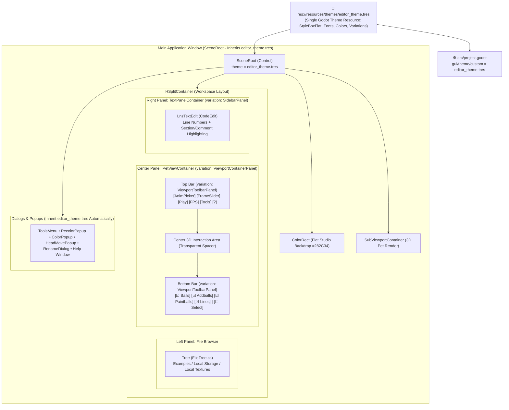

# Modern UI Overhaul & Theme System

## 📖 Overview
Give **LnzLive** ([`src/Scenes/Editor/Editor.tscn`](../../../src/Scenes/Editor/Editor.tscn)) a fresh, timeless visual style by replacing raw, unstyled default Godot controls and the harsh Windows 95 teal background (`Color(0, 0.5, 0.5, 1)` / `#008080`) with a cohesive, flat studio interface.

Rather than introducing a complex user-facing theming system or runtime style switchers, this feature consolidates **all UI styling into a single declarative Godot 4 `Theme` resource** (`res://resources/themes/editor_theme.tres`), references it cleanly at the project and scene root, removes scattered inline node overrides in `Editor.tscn`, and sets a calm, flat 3D viewport background.

## 🎯 Goals & Use Cases
- **Goal 1 (Fresh, Timeless Visual Style with a Flat Background):** Replace default Godot control chrome and the `#008080` background with a clean, low-eye-strain flat dark-slate aesthetic and a single flat 3D viewport backdrop (`SceneRoot/ColorRect`) that lets the Petz 256-color palette (`petzpalette.png`), ball outlines, and pixel-art textures stand out accurately.
- **Goal 2 (Single Declarative Godot `.tres` Theme File):** Define all UI styles (`StyleBoxFlat` surfaces, borders, corner radii, content margins, fonts, and control states) in one static Godot `Theme` resource (`src/resources/themes/editor_theme.tres`)—with zero procedural theme scripts, color pickers, or runtime theme-switching complexity.
- **Goal 3 (Clean Theme Referencing & Zero Inline Clutter):** Reference `editor_theme.tres` globally via `project.godot` (`gui/theme/custom`) and `SceneRoot.theme`, eliminate redundant inline `SubResource` font and style overrides in `Editor.tscn`, and use standard Godot `theme_type_variation` identifiers for specialized UI containers.
- **Goal 4 (Improved Hexing Ergonomics & Visual Hierarchy):** Upgrade the raw `TextEdit` to a `CodeEdit` with `.lnz` syntax highlighting and line numbers, organize the floating 3D viewport controls into structured top and bottom bars, and add clean margins and labels to tool popups (`ToolsMenu`, `RecolorPopup`, `ColorPopup`, `HeadMovePopup`, `RenameDialog`, `Popup`).
- **Use Case A (Distraction-Free Hexing & Inspection):** A breed creator inspecting ball placements, color ramps, outlines, and fuzz in the 3D viewport works against a calm, flat studio background and understated flat panels that never compete visually with the pet's colors.
- **Use Case B (Clean Scene Maintainability):** A developer adding or modifying controls in `Editor.tscn` automatically inherits the project's visual style from `editor_theme.tres` (or selects a `theme_type_variation` in the Inspector) without copying inline `theme_override_*` properties across nodes or writing C# styling code.
- **Use Case C (Extended `.lnz` Editing Comfort):** A user editing `.lnz` files benefits from crisp typography, visible line numbers, and subtle syntax highlighting for `[Section]` headers and comments.

## 👥 Target Audience / User Roles
- **Petz Hexers & Breed Creators:** Users inspecting 3D ball geometry, lines, and paintballs alongside `.lnz` text files.
- **Developers & Maintainers:** Contributors maintaining the Godot 4 scene hierarchy and UI resources without managing procedural styling code.

---

## 🎨 Visual Direction: Timeless Flat Studio

> **Design Philosophy:** Understated, flat, and timeless—inspired by clean 3D/pixel-art inspection tools (Blockbench, Blender flat studio workspaces). Every surface uses flat colors (`StyleBoxFlat`) with subtle `1px` structural borders, consistent `4px` corner radii, and clear typographic contrast. No gradients, drop shadows, shaders, or user theming menus.

### 1. Color Palette & Design Tokens (`editor_theme.tres`)

| Token / Element | Hex Color | Godot `Color` | Usage in Theme & Scene |
| :--- | :--- | :--- | :--- |
| **3D Viewport Flat Backdrop** | `#282C34` | `Color(0.157, 0.173, 0.204, 1)` | `SceneRoot/ColorRect.color` — neutral flat slate behind the 3D pet render |
| **App Shell / Split Background** | `#181A1F` | `Color(0.094, 0.102, 0.122, 1)` | Base background behind `HSplitContainer` grabbers and window chrome |
| **Panel & Sidebar Surface** | `#21252B` | `Color(0.129, 0.145, 0.169, 1)` | `FileTree` sidebar, `LnzTextEdit` background, modal dialog bodies |
| **Toolbar & Control Surface** | `#2C313A` | `Color(0.173, 0.192, 0.227, 1)` | Viewport top/bottom bars, normal `Button`, `OptionButton`, `LineEdit` |
| **Control Hover / Pressed** | `#353B45` / `#3E4451` | `Color(0.208, 0.231, 0.271, 1)` | Subtle flat highlight on button/item hover and active press |
| **Primary Accent** | `#4D9DE0` | `Color(0.302, 0.616, 0.878, 1)` | Toggled `Play` button, selected `Tree` row, `HSlider` fill, input focus border |
| **Text (Primary)** | `#E6EDF3` | `Color(0.902, 0.929, 0.953, 1)` | Primary UI labels, button text, `.lnz` editor body text |
| **Text (Muted / Secondary)** | `#8B949E` | `Color(0.545, 0.580, 0.620, 1)` | Secondary labels (`FPSLabel`, disabled menu items, line numbers, comments) |
| **Structural Borders & Dividers** | `#333842` | `Color(0.200, 0.220, 0.259, 1)` | `1px` flat borders on panels, buttons, inputs, popups, and splitters |

### 2. Clean Referencing via Godot `Theme` & Type Variations

Instead of attaching `theme_override_styles/*` or `theme_override_fonts/*` directly onto individual nodes in `Editor.tscn`, all styling lives inside `res://resources/themes/editor_theme.tres` and is referenced through base control types or Godot's built-in **`theme_type_variation`** property:

| Base Control Type | `theme_type_variation` | Target Node(s) in `Editor.tscn` | Purpose |
| :--- | :--- | :--- | :--- |
| *(All Standard Controls)* | *(Empty — Default)* | `Button`, `CheckBox`, `OptionButton`, `HSlider`, `Tree`, `LineEdit`, `CodeEdit`, `PopupMenu`, `Window` | Automatically styled via base type definitions in `editor_theme.tres` |
| `PanelContainer` | `"ViewportContainerPanel"` | `PetViewContainer` | Uses `StyleBoxEmpty` defined in the theme so the flat `ColorRect` and `SubViewportContainer` show through cleanly (replaces inline `SubResource("2")`) |
| `PanelContainer` | `"ViewportToolbarPanel"` | `TopToolbarPanel`, `BottomStatusPanel` | Flat `#21252B` bar surface with `1px` `#333842` border and `8px` horizontal / `6px` vertical content margins |
| `PanelContainer` | `"SidebarPanel"` | Left `FileTree` container & Right `TextPanelContainer` | Flat `#21252B` panel surface with clean internal padding and `1px` border |
| `Label` | `"BallHoverLabel"` | `SceneRoot/Label` | Compact flat pill badge (`#181A1F` background, `1px` border, `4px` padding) for hovered 3D ball inspection (replaces inline `SubResource("3")`) |

---

## ⚙️ Functional Requirements
- [x] **Requirement 1 (Centralized Godot 4 `Theme` Resource):**
  - Create a single static Godot `Theme` file at `src/resources/themes/editor_theme.tres`.
  - Define flat `StyleBoxFlat` resources, font references (`DroidSans.ttf` / clean monospace fallback), colors, and margin constants for all controls used in the project:
    - `PanelContainer`, `Button`, `CheckBox`, `OptionButton`, `LineEdit`, `CodeEdit` / `TextEdit`, `Tree`, `HSlider`, `HSplitContainer`, `PopupMenu`, `Window`, `AcceptDialog`, and `ConfirmationDialog`.
  - Configure `gui/theme/custom="res://resources/themes/editor_theme.tres"` in [`src/project.godot`](../../../src/project.godot) and set `theme = ExtResource(...)` on `SceneRoot` in [`src/Scenes/Editor/Editor.tscn`](../../../src/Scenes/Editor/Editor.tscn) so the entire application and all popups inherit the theme automatically both in-editor and at runtime.
- [x] **Requirement 2 (Eliminate Inline Theme Overrides in `Editor.tscn`):**
  - Remove the redundant inline sub-resources from [`src/Scenes/Editor/Editor.tscn`](../../../src/Scenes/Editor/Editor.tscn):
    - Delete `SubResource("2")` (`StyleBoxEmpty` on `PetViewContainer`) and replace it with `theme_type_variation = &"ViewportContainerPanel"`.
    - Delete duplicate `FontFile` sub-resources `SubResource("3")`, `SubResource("4")`, and `SubResource("5")` on `SceneRoot/Label` and `SceneRoot/Popup/RichTextLabel`, relying instead on the default font and `RichTextLabel` font table configured in `editor_theme.tres`.
- [x] **Requirement 3 (Flat, Timeless 3D Viewport Backdrop):**
  - Update `SceneRoot/ColorRect.color` in [`src/Scenes/Editor/Editor.tscn`](../../../src/Scenes/Editor/Editor.tscn) from `Color(0, 0.5, 0.5, 1)` (`#008080`) to a flat neutral studio slate (`Color(0.157, 0.173, 0.204, 1)` / `#282C34`).
  - Keep the backdrop strictly flat—no gradients, vignettes, shaders, or color picker controls.
- [x] **Requirement 4 (Structured 3D Viewport Top & Bottom Bars):**
  - Wrap the top control row (`HBoxContainer`) and bottom visibility row (`HBoxContainer2`) inside `PetViewContainer/VBoxContainer` in `PanelContainer` nodes using `theme_type_variation = &"ViewportToolbarPanel"`, separated by an expanding transparent spacer (`Control` with `size_flags_vertical = SIZE_EXPAND_FILL`, `mouse_filter = MOUSE_FILTER_IGNORE`) so the top bar sits cleanly at the top and the visibility/selection bar sits cleanly at the bottom of the 3D viewport:
    - **Top Animation & Transport Bar:**
      - `AnimPicker` (`OptionButton`), `PlayButton` (`Button` with toggle state), `FrameSlider` (`HSlider`), `FPSLabel` (`Label`), plus a **`Tools`** button (opening `ToolsMenu`) and a **`?`** button (wired to the existing `PetViewContainer.OnHelpButtonPressed()` method).
    - **Bottom Render Filter & Selection Bar:**
      - `BallCheckBox` (`Draw balls`), `AddballCheckBox` (`Draw addballs`), `PaintballCheckBox` (`Draw paintballs`), `LineCheckBox` (`Draw lines`), and `SelectCheckBox` (`Select`).
- [x] **Requirement 5 (Upgraded LNZ Code Editor):**
  - Change `LnzTextEdit` node type in [`src/Scenes/Editor/Editor.tscn`](../../../src/Scenes/Editor/Editor.tscn) and base class in [`src/UI/LnzTextEdit.cs`](../../../src/UI/LnzTextEdit.cs) from `TextEdit` to `CodeEdit` (which inherits directly from `TextEdit` in Godot 4).
  - Enable line numbers (`gutters_draw_line_numbers = true`) and configure a lightweight `CodeHighlighter` for `.lnz` `[Section]` headers and `;` / `#` comments using muted, timeless syntax colors aligned with `editor_theme.tres`.
- [x] **Requirement 6 (Clean Modal Dialogs & Tool Popups):**
  - Upgrade `ColorPopup` and `HeadMovePopup` from bare `Popup` nodes to `PopupPanel` (or include a themed `PanelContainer` child) so they automatically render with the flat panel background, `1px` border, and padding from `editor_theme.tres`.
  - Add clear field labels/placeholders (`Base Color`, `Outline Color`, `X / Y / Z Offset`) and window titles to `ColorPopup`, `HeadMovePopup`, `RecolorPopup`, `RenameDialog`, and `Popup` (Help window).

---

## 🎨 UI/UX Design & Interactions

### Layout & Theme Inheritance Architecture

### Key UX & Architectural Benefits
1. **Single Source of Truth (`editor_theme.tres`):**
   - Every button state (normal, hover, pressed, disabled, focus), input box, tree list, scrollbar, slider, and dialog border is defined once in `src/resources/themes/editor_theme.tres`.
2. **Flat, Non-Distracting Backdrop:**
   - Replacing `#008080` with a flat neutral dark slate (`#282C34`) eliminates harsh cyan color casts while inspecting pet ball outlines and textures.
3. **Discoverable Existing Tools & Help:**
   - Exposing `Tools` and `?` buttons in the top viewport bar makes existing functionality (`ToolsMenu` and `PetViewContainer.OnHelpButtonPressed()`) immediately accessible without requiring users to know hidden keyboard shortcuts.

---

## 💻 Technical Details

### 1. Theme Resource Organization (`src/resources/themes/editor_theme.tres`)
- **Fonts:**
  - `default_font`: References `res://new_dynamicfontdata.tres` (or relocated `res://resources/fonts/droid_sans_font.tres` if paired with [`Godot-Project-Directory-Reorganization.md`](Godot-Project-Directory-Reorganization.md)) with `default_font_size = 14`.
- **Core `StyleBoxFlat` Sub-Resources inside `editor_theme.tres`:**
  - `panel_sidebar`: `bg_color = #21252B`, `border_color = #333842`, `border_width_* = 1`, `content_margin_* = 8`.
  - `panel_toolbar`: `bg_color = #21252B`, `border_color = #333842`, `border_width_bottom = 1`, `corner_radius_* = 4`, `content_margin_left/right = 8`, `content_margin_top/bottom = 6`.
  - `button_normal`: `bg_color = #2C313A`, `border_color = #333842`, `border_width_* = 1`, `corner_radius_* = 4`, `content_margin_left/right = 10`, `content_margin_top/bottom = 5`.
  - `button_hover`: `bg_color = #353B45`, `border_color = #4B5263`, `border_width_* = 1`, `corner_radius_* = 4`.
  - `button_pressed`: `bg_color = #4D9DE0` (or `#1F2329` for inputs), `border_color = #4D9DE0`, `border_width_* = 1`, `corner_radius_* = 4`.
  - `input_normal` (`LineEdit`, `CodeEdit`, `Tree`): `bg_color = #181A1F`, `border_color = #333842`, `border_width_* = 1`, `corner_radius_* = 4`, `content_margin_* = 6`.
  - `input_focus`: `bg_color = #181A1F`, `border_color = #4D9DE0`, `border_width_* = 1`, `corner_radius_* = 4`.
  - `popup_panel` (`PopupMenu`, `PopupPanel`, `AcceptDialog`, `ConfirmationDialog`, `Window`): `bg_color = #21252B`, `border_color = #333842`, `border_width_* = 1`, `corner_radius_* = 4`, `content_margin_* = 10`.

### 2. Project & Scene Updates
- **[`src/project.godot`](../../../src/project.godot):**
  - Add `[gui]` section with `theme/custom="res://resources/themes/editor_theme.tres"`.
- **[`src/Scenes/Editor/Editor.tscn`](../../../src/Scenes/Editor/Editor.tscn):**
  - Add `[ext_resource type="Theme" path="res://resources/themes/editor_theme.tres" id="13"]` and set `theme = ExtResource("13")` on `SceneRoot`.
  - Update `SceneRoot/ColorRect` `color` property to `Color(0.157, 0.173, 0.204, 1)`.
  - Remove `SubResource("2")`, `SubResource("3")`, `SubResource("4")`, and `SubResource("5")` and all inline `theme_override_styles/*` and `theme_override_fonts/*` properties on individual nodes.
  - Set `theme_type_variation = &"ViewportContainerPanel"` on `PetViewContainer` and `"BallHoverLabel"` on `SceneRoot/Label`.
  - Wrap `PetViewContainer/VBoxContainer/HBoxContainer` and `HBoxContainer2` in `PanelContainer` nodes with `theme_type_variation = &"ViewportToolbarPanel"` and insert an expanding spacer `Control` (`mouse_filter = 2`) between them so `HBoxContainer2` docks to the bottom of the viewport.
  - Change `LnzTextEdit` node type from `TextEdit` to `CodeEdit` with `gutters_draw_line_numbers = true`.
- **[`src/UI/LnzTextEdit.cs`](../../../src/UI/LnzTextEdit.cs):**
  - Change class declaration from `public partial class LnzTextEdit : TextEdit` to `public partial class LnzTextEdit : CodeEdit`.
  - In `_Ready()`, configure a `CodeHighlighter` instance for `.lnz` comments (`;` and `#` color regions in muted `#8B949E`) and `[Section]` headers (`[` to `]` color region in accent `#4D9DE0`).
- **[`src/UI/PetViewContainer.cs`](../../../src/UI/PetViewContainer.cs):**
  - Connect the new top-bar `?` (`HelpButton`) `pressed` signal to the existing `OnHelpButtonPressed()` method and the `Tools` (`ToolsButton`) `pressed` signal to open `ToolsMenu` centered or below the button.

---

## 🧪 Testing Plan
- **Theme Inheritance & Clean Reference Verification:**
  - Inspect `Editor.tscn` to confirm zero inline `theme_override_*` properties remain on individual nodes and that `editor_theme.tres` styles all panels, buttons, checkboxes, sliders, tree items, text editors, and popups cleanly.
- **Visual Consistency & Flat Background Check:**
  - Launch the application and load both light-colored (`snowball.lnz`, `calico.lnz`) and dark-colored (`scottie.lnz`, `black_cat.lnz`) pets. Verify that the flat `#282C34` viewport backdrop provides comfortable contrast for inspecting ball outlines and fuzz without visual clutter.
- **Popup & Dialog Styling Check:**
  - Open `ToolsMenu`, `RecolorMenu`, `ColorPopup`, `RecolorPopup` (`Color Swap`), `HeadMovePopup`, `RenameDialog`, and `Popup` (Help window) to verify that all modals and popups inherit flat panel backgrounds, readable typography, and clean padding from `editor_theme.tres`.
- **Editor & Viewport Interaction Regressions:**
  - Verify that `Select` mode 3D ball raycasting (`PetViewContainer.cs`), camera rotation/pan/zoom, `AnimPicker`, `FrameSlider`, `Ctrl+S` saving, `Ctrl+Q` ball flashing, and `.lnz` editing in `CodeEdit` work identically.

## 🔗 Related Resources
- [`src/project.godot`](../../../src/project.godot)
- [`src/Scenes/Editor/Editor.tscn`](../../../src/Scenes/Editor/Editor.tscn)
- [`src/Scenes/Editor/RecolorLine.tscn`](../../../src/Scenes/Editor/RecolorLine.tscn)
- [`src/UI/PetViewContainer.cs`](../../../src/UI/PetViewContainer.cs)
- [`src/UI/LnzTextEdit.cs`](../../../src/UI/LnzTextEdit.cs)
- [`src/UI/ToolsMenu.cs`](../../../src/UI/ToolsMenu.cs)
- [`src/UI/FileTree.cs`](../../../src/UI/FileTree.cs)
- [`doc/features/review/Godot-Project-Directory-Reorganization.md`](Godot-Project-Directory-Reorganization.md)
