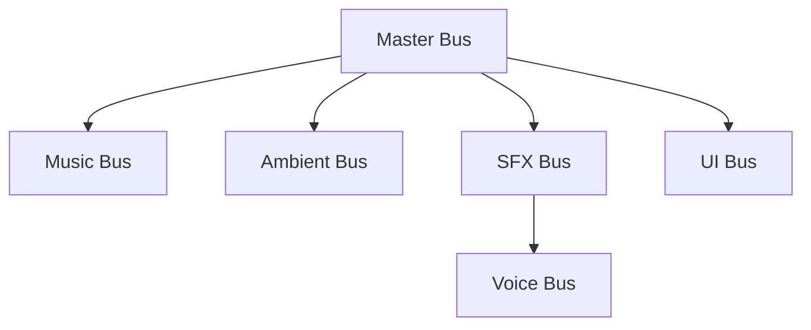

# Feature: Audio FX & Music Integration with Options Volume Controls

## 📖 Overview

Audio effects (SFX) and background music (BGM) are essential for providing visceral feedback, tactical clarity, and atmospheric immersion in **IsoTactics**. This feature establishes the concrete implementation plan for introducing sound effects and music into the game, integrating them into the centralized `IAudioService` architecture, providing a developer feature toggle for background music, and connecting the volume sliders in the Game Options screen (`ScrOptions.tscn` / `ScrOptionsController.cs`) to Godot's audio buses.

Rather than attempting to produce all final sound effects at once, this document defines a curated **Starter Sound List** and **Starter Music Palette** representing the minimum viable audio palette needed for immediate gameplay testing (UI feedback, player foley, basic weapons, tactical cues, and cyberpunk background tracks). It also details the wiring for the six audio volume buses (`Master`, `Music`, `SFX`, `Voice`, `Ambient`, and `UI`), the developer feature toggle (`EnableMusic`), and references the developer workflow documented in `doc/90 Development Flows.md`.

---

## 🎯 Goals & Use Cases

- **Goal 1 — Instant Audio Feedback (Game Feel):** Ensure that every player input (hovering buttons, clicking menus, selecting units, firing weapons, confirming orders) provides an immediate, tactile audio response.
- **Goal 2 — Audio Service Integration:** Connect all sound effect and music playback to the centralized `IAudioService` via dependency injection (`ServiceLocator`), utilizing audio pooling and sound culling to avoid clipping and performance dips.
- **Goal 3 — Functional Options Screen Volume Controls:** Wire up the existing volume sliders in `ScrOptionsController.cs` so player volume adjustments immediately affect Godot's `AudioServer` buses and persist between play sessions.
- **Goal 4 — Developer Music Feature Toggle:** Provide a frictionless configuration toggle (`EnableMusic` in `FeatureConfig.tres` and `IFeatureService.IsMusicEnabled`) allowing developers to mute/disable music during development and audio testing without having to alter in-game settings.
- **Goal 5 — Clear Developer Workflow:** Provide a streamlined and documented path for designers and developers to add new `.wav`, `.ogg`, and `.mp3` files into the project (delivered in `doc/90 Development Flows.md`).

### Use Cases

| Scenario | Expected Behavior |
|---|---|
| Player hovers over or clicks a button in any menu | `SfxUiHover` / `SfxUiClick` plays immediately on the `UI` bus. |
| Player selects a tactical operative on the map | Operative highlights and `SfxSelection` plays (with future support for character voice barks). |
| Operative walks across concrete / metal tiles | Footstep audio (`SfxFootstepConcrete` / `SfxFootstepMetal`) triggers in sync with walk animation frames, spatialized in 2D at the character's position. |
| Character fires a handgun | `SfxPistolFire` triggers at character position on `SFX` bus; slight randomized pitch variation (+/- 5%) prevents repetitive acoustic fatigue. |
| Player launches the game (Title / Splash Screen) | Main menu theme (`BgmMainMenu.mp3`) starts playing immediately on the `Music` bus. |
| Player transitions to Main Menu or Safehouse Hub | `BgmMainMenu.mp3` continues seamlessly without interruption. |
| Level loads in `SysMainGameWindow` | Music switches to the in-game playlist, cycling endlessly across `game_music_01` through `game_music_04`. |
| Developer disables `EnableMusic` in `FeatureConfig.tres` | Music playback is immediately silenced/prevented during local development sessions. |
| Player adjusts "SFX Volume" slider in Options | Godot's `SFX` audio bus volume updates in real time using logarithmic decibel conversion; slider position persists across scene reloads. |

---

## 👥 Target Audience / User Roles

- **Players:** Enjoy a tactile, responsive game feel with full player control over individual sound channels.
- **Sound Designers / Technical Artists:** Have a defined folder structure, naming convention, and import guideline for exporting and testing audio assets.
- **Gameplay Programmers:** Have clean, mockable API methods (`PlaySFX`, `PlaySFX2D`) exposed via `IAudioService` through the DI container.

---

## 🔊 Starter Sound List (MVP Audio Palette)

To get audio into the build quickly without waiting for full sound design passes, the following **18 essential sounds** constitute the initial starter sound package.

### Audio Technical Specifications
- **Format:** Uncompressed 16-bit or 24-bit PCM `.wav` at 44.1 kHz or 48.0 kHz.
- **Channels:** 
  - **Mono** for all in-world / positional 2D sound effects (required by Godot for 2D spatial panning and distance attenuation).
  - **Stereo** for UI sounds and master stings.
- **Mastering Peak:** Normalized to -3.0 dB to -1.0 dB to leave headroom for bus mixing.
- **Naming Standard:** Must strictly adhere to `doc/93 Resource Naming.md` with the `Sfx` prefix in `PascalCase`.

### 🛠️ Primary Tooling: rFXGen (`tools\Sound\rfxgen_v5.0_win_x64`)

The primary generator for all starter and tactical sound effects is **rFXGen** (located in the repository at [`tools\Sound\rfxgen_v5.0_win_x64\rfxgen.exe`](file:///d:/Data/OneDrive/12%20Areas/Ideas/IsoTactics/tools/Sound/rfxgen_v5.0_win_x64/rfxgen.exe)). 

- **Preset Mapping for Starter Audio:**
  - **UI Feedback (`ui_click`, `ui_hover`, `ui_cancel`):** Generated using the `blip` and `coin` presets with short decay times and high-frequency square/sine waves.
  - **Footsteps & Movement (`footstep_*`, `vault_rustle`):** Generated using the `hit` preset with high noise blending, low-pass filter enabled, and very brief attack/decay envelopes.
  - **Firearms (`pistol_fire`):** Generated blending `laser` and `explosion` presets: fast descending pitch envelope, sharp noise transient attack, and short decay.
  - **Impacts (`impact_concrete`, `impact_body`):** Generated using the `hit` and `explosion` presets with heavy noise and quick low-pass dampening.
  - **Tactical Cues (`tactical_select`, `overwatch_trigger`):** Generated using the `powerup` preset (clean multi-tone ascending frequency ramps).
- **Source Preservation (`./snd`):**
  All sound source files and synthesis parameter presets (`.rfx` files, 104 bytes each) are centralized in the root directory [`./snd`](file:///d:/Data/OneDrive/12%20Areas/Ideas/IsoTactics/snd/). Keeping source files in `./snd` mirrors how visual reference/source assets live in `./img`, separating source authoring files from exported runtime assets in `src/assets/audio/`. This guarantees that any team member can reopen the patch, tweak parameters (e.g. adjust decay or distortion), and re-export.
- **Batch & CLI Export Support:**
  rFXGen can be run via command line to re-render files deterministically:
  ```cmd
  tools\Sound\rfxgen_v5.0_win_x64\rfxgen.exe --input snd\SfxFootstepConcrete.rfx --output src\assets\audio\sfx\SfxFootstepConcrete.wav --format 44100,16,1
  ```


### Priority 1: User Interface & Menu Feedback (Stereo)

| Key | Proposed File Name | Bus | Description & Purpose |
|---|---|---|---|
| `ui_hover` | `SfxUiHover.wav` | `UI` | Subtle high-frequency tick when mouse cursor enters buttons or clickable cards. |
| `ui_click` | `SfxUiClick.wav` | `UI` | Tactile mechanical click on button press. |
| `ui_confirm` | `SfxUiConfirm.wav` | `UI` | Positive chime / confirmation tone when launching a mission or confirming an action. |
| `ui_cancel` | `SfxUiCancel.wav` | `UI` | Low subtle tone when closing a modal, pressing Back, or clearing a target. |
| `ui_error` | `SfxUiError.wav` | `UI` | Muted buzz or warning thump when attempting an invalid action or moving out of AP. |

### Priority 2: Movement & Foley (2D Positional Mono)

| Key | Proposed File Name | Bus | Description & Purpose |
|---|---|---|---|
| `footstep_concrete_01` | `SfxFootstepConcrete01.wav` | `SFX` | Hard shoe impact on asphalt/concrete floor (variation 1). |
| `footstep_concrete_02` | `SfxFootstepConcrete02.wav` | `SFX` | Hard shoe impact on asphalt/concrete floor (variation 2). |
| `footstep_metal_01` | `SfxFootstepMetal01.wav` | `SFX` | Footstep on metal catwalk / grating. |
| `vault_rustle` | `SfxVaultRustle.wav` | `SFX` | Quick cloth and gear rustle when leaping over half-cover barriers. |

### Priority 3: Basic Weapons & Combat (2D Positional Mono)

| Key | Proposed File Name | Bus | Description & Purpose |
|---|---|---|---|
| `pistol_fire` | `SfxPistolFire.wav` | `SFX` | Punchy 9mm gunshot with short indoor reverb tail. |
| `pistol_reload` | `SfxPistolReload.wav` | `SFX` | Magazine ejection, insertion click, and slide rack. |
| `weapon_empty_click` | `SfxWeaponEmptyClick.wav` | `SFX` | Dry-fire metallic click when attempting to fire without ammo. |
| `impact_concrete` | `SfxImpactConcrete.wav` | `SFX` | Bullet strike on concrete wall or floor (sparks and debris). |
| `impact_body` | `SfxImpactBody.wav` | `SFX` | Bullet hit on flesh/armor (flesh thud and pain cue). |

### Priority 4: Tactical Feedback & Environment (Stereo / 2D Positional)

| Key | Proposed File Name | Bus | Description & Purpose |
|---|---|---|---|
| `tactical_select` | `SfxTacticalSelect.wav` | `SFX` | Radio chirp / selection ping when selecting an operative. |
| `turn_end` | `SfxTurnEnd.wav` | `SFX` | Deep whoosh signaling turn transition or phase switch. |
| `overwatch_trigger` | `SfxOverwatchTrigger.wav` | `SFX` | Staccato warning chime when an enemy enters an active overwatch cone. |
| `door_open` | `SfxDoorOpen.wav` | `SFX` | Heavy warehouse door latch and swing. |

### Priority 5: Starter Music Palette (BGM — Stereo MP3 / OGG)

Source audio files placed in root [`./snd/Music/`](file:///d:/Data/OneDrive/12%20Areas/Ideas/IsoTactics/snd/Music/) are prepared for runtime playback under [`src/assets/audio/music/`](file:///d:/Data/OneDrive/12%20Areas/Ideas/IsoTactics/src/assets/audio/music/) conforming to [`doc/93 Resource Naming.md`](file:///d:/Data/OneDrive/12%20Areas/Ideas/IsoTactics/doc/93%20Resource%20Naming.md):

| Registry Key | Source File (`./snd/Music/`) | Runtime File (`src/assets/audio/music/`) | Bus | Description & Purpose |
|---|---|---|---|---|
| `menu_music` | `cyberpunk menu music 1.mp3` | `BgmMainMenu.mp3` | `Music` | Dark synth cyberpunk track for Splash & Main Menu screens. |
| `game_music_01` | `cyberpunk in game music 1.mp3` | `BgmInGame01.mp3` | `Music` | Mid-tempo tactical combat / exploration track 1. |
| `game_music_02` | `cyberpunk in game music 2.mp3` | `BgmInGame02.mp3` | `Music` | Tense atmosphere track 2 with pulsing basslines. |
| `game_music_03` | `cyberpunk in game music 3.mp3` | `BgmInGame03.mp3` | `Music` | High-tension tactical encounter track 3. |
| `game_music_04` | `cyberpunk in game music 4.mp3` | `BgmInGame04.mp3` | `Music` | Dynamic mission loop track 4. |

---

## ⚙️ Functional Requirements

### 1. Audio Service Contract & Playback
- [x] **REQ-SFX-01:** Expose `void PlaySFX(string sfxKey, float pitchVariation = 0.05f)` in `IAudioService` for non-positional audio (UI, global stings).
- [x] **REQ-SFX-02:** Expose `void PlaySFX2D(string sfxKey, Vector2 worldPosition, float pitchVariation = 0.05f)` in `IAudioService` for positional world audio.
- [x] **REQ-SFX-03:** Maintain an internal pool of pre-instantiated `AudioStreamPlayer2D` nodes parented under `AudioService` to eliminate runtime allocation stutter.
- [ ] **REQ-SFX-04:** Implement sound culling (`MaxSimultaneousInstances = 2` for footsteps and gunshots per frame) to prevent audio distortion when multiple entities act simultaneously.
- [x] **REQ-SFX-05:** Implement automatic pitch modulation: randomize playback `PitchScale` within `[1.0 - variation, 1.0 + variation]` for repeated sounds to reduce acoustic monotony.
- [x] **REQ-SFX-06:** Register `IAudioService` as a singleton in `GameBootstrapper.cs` and initialize it via `ServiceLocator`.

### 2. Options Screen Volume Wiring
- [x] **REQ-VOL-01:** Wire all six volume sliders in `ScrOptions.tscn` (`MasterVol`, `MusicVol`, `SfxVol`, `VoiceVol`, `AmbientVol`, `UiVol`) to signal handlers in `ScrOptionsController.cs`.
- [x] **REQ-VOL-02:** Convert the slider value (0.0 to 100.0) to linear scale (0.0 to 1.0) and map to decibels using Godot's logarithmic formula: `db = Mathf.LinearToDb(linear)`.
- [x] **REQ-VOL-03:** When a slider reaches 0.0, automatically mute the corresponding Godot Audio Bus via `AudioServer.SetBusMute(busIndex, true)` and set volume to `-80.0f` dB to guarantee complete silence.
- [ ] **REQ-VOL-04:** Persist all volume settings into a local configuration file (`user://settings.cfg` or via `ISettingsService`) so player preferences are restored upon game launch.
- [x] **REQ-VOL-05:** Provide immediate audio feedback: when releasing or adjusting the SFX or UI slider, play a sample `SfxUiClick` cue on that bus so the player hears the volume level they selected.

### 3. Background Music (BGM), Playlists & Developer Feature Toggle
- [x] **REQ-BGM-01:** Expose `void PlayMusic(string musicKey, float fadeDuration = 1.0f)` and `void StopMusic(float fadeDuration = 1.0f)` in `IAudioService`.
- [x] **REQ-BGM-02:** Route music player to the dedicated `Music` audio bus (`AudioServer`) for independent volume scaling and DSP chaining.
- [x] **REQ-BGM-03:** Provide a development feature toggle `EnableMusic` in `FeatureConfig.tres` and `IFeatureService.IsMusicEnabled`. When set to `false`, `PlayMusic` and playlists immediately skip or halt playback for developer convenience.
- [x] **REQ-BGM-04:** Wire title/splash screen (`ScrSplashScreenController.cs`) and main menu (`ScrMainMenuController.cs`) to start `menu_music` immediately upon boot.
- [x] **REQ-BGM-05:** Implement endless repeating in-game playlist support (`PlayMusicPlaylist` and `PlayInGameMusic`), advancing tracks automatically via `AudioStreamPlayer.Finished` across `game_music_01` through `game_music_04`.
- [x] **REQ-BGM-06:** Wire in-game music playlist activation in `SysMainGameWindow.cs` when a level is loaded.

---

## 🎨 UI/UX Design & Interactions

### Options Menu Audio Tab Layout
The Audio Tab in `src/UI/Menus/Options/ScrOptions.tscn` contains six horizontal sliders (`HSlider`) grouped with descriptive labels:

```
[ Options: Audio ]
------------------------------------------------------
Master Volume    [==========|=========] 80%
Music Volume     [=======|============] 70%
SFX Volume       [====================] 100%
Voice Volume     [==================|==] 90%
Ambient Volume   [=====|==============] 50%
UI Volume        [======|=============] 60%
------------------------------------------------------
[ Back ]
```

### Controller Navigation
- **Keyboard / Gamepad Support:** The existing controller logic in `ScrOptionsController.cs` routes `ui_menu_up` / `ui_menu_down` to navigate between sliders and `ui_menu_left` / `ui_menu_right` to step slider values by `Step = 5.0`.
- **Numerical Feedback:** Each slider row will include a label displaying the current percentage (e.g., `80%`) updated dynamically during slider movement.

---

## 💻 Technical Details

### 1. Godot Audio Server & Bus Layout Architecture

The audio system directly and comprehensively leverages Godot's built-in **AudioServer** and **Audio Bus Layout** pipeline (`AudioBusLayout`). Rather than managing volume levels, fading, or signal processing on individual `AudioStreamPlayer` instances, all audio routing, mixing, volume modulation, and DSP effects are offloaded to Godot's native C++ audio engine.

#### A. Bus Hierarchy & Routing (`default_bus_layout.tres`)
The project configures its master bus tree in [`src/default_bus_layout.tres`](file:///d:/Data/OneDrive/12%20Areas/Ideas/IsoTactics/src/default_bus_layout.tres) and binds it in [`src/project.godot`](file:///d:/Data/OneDrive/12%20Areas/Ideas/IsoTactics/src/project.godot) via `audio/buses/default_bus_layout`:



- **`Master` (Bus 0):** Hardware master output. Controls overall game volume. All root buses route into Master.
- **`Music` (Bus 1):** Routes background score (`Bgm`). Sends to `Master`.
- **`Ambient` (Bus 2):** Routes environmental ambience loops and weather audio (`Amb`). Sends to `Master`.
- **`SFX` (Bus 3):** Routes tactical weapons, footstep foley, door mechanics, and physical explosions (`Sfx`). Sends to `Master`.
- **`Voice` (Bus 4):** Routes character barks and tactical radio chatter (`Voice`). Sends to `SFX`, enabling unified sub-mix ducking or filtering under the SFX group.
- **`UI` (Bus 5):** Routes menu clicks, button hovers, slider adjustments, and HUD alerts (`UI`). Sends directly to `Master`, ensuring UI feedback remains audible and crisp even when tactical SFX are quieted or heavily filtered.

#### B. How the Audio Service Leverages Godot's AudioServer
1. **Zero Per-Player Volume Modification:**
   Player instances (`AudioStreamPlayer` and `AudioStreamPlayer2D`) never have their `VolumeDb` adjusted manually for volume settings. Their output volume is entirely controlled by their assigned `player.Bus`.
2. **Native Bus Assignment:**
   - **UI Audio:** [`UiPlayer`](file:///d:/Data/OneDrive/12%20Areas/Ideas/IsoTactics/src/Core/Services/Implementations/AudioService.cs#L16) is assigned to `Bus = "UI"` by default.
   - **Positional 2D SFX:** All players in [`SfxPool`](file:///d:/Data/OneDrive/12%20Areas/Ideas/IsoTactics/src/Core/Services/Implementations/AudioService.cs#L18) are pre-assigned to `Bus = "SFX"`.
3. **Dynamic Target Bus Routing (Preview Audio):**
   `IAudioService.PlaySFX` accepts an optional `targetBus` parameter. When the player adjusts a slider in the Options menu (e.g., Master, Music, SFX, Voice, Ambient, UI), the service dynamically switches `UiPlayer.Bus = targetBus` before triggering playback. This allows players to audibly sample the exact bus volume level they just tuned.
4. **Decibel Conversion & Hardware Muting via `AudioServer`:**
   Volume adjustments from the UI sliders (0.0 to 1.0 linear) are converted into decibels via `Mathf.LinearToDb(linearVolume)` and applied directly to the hardware bus using `AudioServer.SetBusVolumeDb(busIndex, db)`. When a slider reaches 0, `AudioServer.SetBusMute(busIndex, true)` is engaged and volume set to `-80.0 dB`, preventing audio bleed.
5. **Runtime Bus Verification & Self-Healing (`EnsureAudioBuses`):**
   To prevent runtime crashes if `default_bus_layout.tres` is missing or edited, `AudioService` checks for required buses via `AudioServer.GetBusIndex(busName)` during startup. If any bus is missing, it dynamically adds it using `AudioServer.AddBus()`, `AudioServer.SetBusName()`, and `AudioServer.SetBusSend()`.
6. **DSP Effect Extensibility:**
   Because all sound routes through Godot's audio buses, audio designers can attach native Godot DSP effects (such as `AudioEffectReverb`, `AudioEffectLowPassFilter`, `AudioEffectCompressor`, or `AudioEffectAmplify`) directly onto any bus in the Godot Editor. The game code requires no modifications to support these effects.

### 2. Volume Conversion Math
Godot uses decibels (dB) for bus amplification, whereas sliders operate on a 0–100 integer/float scale. The conversion logic in C# is:

```csharp
private void SetBusVolume(int busIndex, double sliderValue)
{
    float linear = (float)(sliderValue / 100.0);
    if (linear <= 0.001f)
    {
        AudioServer.SetBusMute(busIndex, true);
        AudioServer.SetBusVolumeDb(busIndex, -80.0f);
    }
    else
    {
        AudioServer.SetBusMute(busIndex, false);
        float db = Mathf.LinearToDb(linear);
        AudioServer.SetBusVolumeDb(busIndex, db);
    }
}
```

### 3. Controller Wiring in `ScrOptionsController.cs`
Following project coding standards (Allman style, explicit `this.`, `#region` blocks, XML comments, and `result` variables):

```csharp
#region InitializeAudioSliders
/// <summary>
/// Connects the volume sliders in the Audio tab to their respective audio buses.
/// </summary>
private void InitializeAudioSliders()
{
    this.ConnectSlider("MasterVol", "Master");
    this.ConnectSlider("MusicVol", "Music");
    this.ConnectSlider("SfxVol", "SFX");
    this.ConnectSlider("VoiceVol", "Voice");
    this.ConnectSlider("AmbientVol", "Ambient");
    this.ConnectSlider("UiVol", "UI");
}
#endregion InitializeAudioSliders

#region OnVolumeChanged
/// <summary>
/// Event handler triggered when any volume slider value changes.
/// </summary>
private void OnVolumeChanged(string busName, double value)
{
    int busIndex = AudioServer.GetBusIndex(busName);
    if (busIndex >= 0)
    {
        this.ApplyVolumeToBus(busIndex, value);
        this.SaveVolumePreference(busName, value);
    }
    else
    {
        //Do nothing
    }
}
#endregion OnVolumeChanged
```

### 4. Audio Service Implementation
- **Contract:** [`src/Core/Services/Contracts/IAudioService.cs`](file:///d:/Data/OneDrive/12%20Areas/Ideas/IsoTactics/src/Core/Services/Contracts/IAudioService.cs)
- **Implementation:** [`src/Core/Services/Implementations/AudioService.cs`](file:///d:/Data/OneDrive/12%20Areas/Ideas/IsoTactics/src/Core/Services/Implementations/AudioService.cs) (Godot `Node` singleton parented under `ServiceLocator`)

```csharp
public partial class AudioService : Node, IAudioService
{
    #region PlaySFX
    /// <summary>
    /// Plays a non-positional sound effect with optional pitch variation and target audio bus routing.
    /// </summary>
    public void PlaySFX(string sfxKey, float pitchVariation = 0.05f, string targetBus = null)
    {
        this.EnsureInitialized();

        AudioStream stream = this.GetAudioStream(sfxKey);
        if (stream != null && this.UiPlayer != null)
        {
            string busToUse = !string.IsNullOrEmpty(targetBus) ? targetBus : "UI";
            int busIndex = AudioServer.GetBusIndex(busToUse);
            this.UiPlayer.Bus = busIndex >= 0 ? busToUse : "UI";

            this.UiPlayer.Stream = stream;
            float variation = pitchVariation > 0 ? (float)GD.RandRange(-pitchVariation, pitchVariation) : 0.0f;
            this.UiPlayer.PitchScale = 1.0f + variation;
            this.UiPlayer.Play();
        }
        else
        {
            //Do nothing
        }
    }
    #endregion PlaySFX
}
```

---

## 🧪 Testing Plan

- [ ] **Bus Volume Test:** Adjust each slider from 0% to 100% in the Options screen and verify via the Godot Audio panel that the bus dB values move from `-80.0 dB` to `0.0 dB`.
- [ ] **Mute Verification:** Verify that dragging a slider to 0% completely mutes the channel with zero audio bleed.
- [ ] **Persistence Test:** Change all sliders to custom values (e.g., Music = 40%, SFX = 90%), close the game, re-launch, and confirm the sliders retain their previous positions and the audio buses are initialized to those levels.
- [ ] **Culling & Pool Test:** Trigger 10 simultaneous footsteps in one frame; verify in the Godot debugger that only 2 footstep sounds play and no memory allocation occurs.
- [ ] **Pitch Variation Test:** Trigger `SfxPistolFire` 5 times in rapid succession; confirm that each shot has a subtle pitch difference, avoiding the machine-gun "identical sample" effect.
- [ ] **Music Feature Toggle Test:** Toggle `EnableMusic` in `FeatureConfig.tres` to `false`; verify that entering Main Menu results in silence on the `Music` bus. Re-enable (`true`) and verify `BgmMainMenu` plays cleanly on the `Music` bus.

---

## 🔗 Deliverables & Related Resources

1. **Development Flow Deliverable:**
   - Full guide on where and how to integrate audio files is added to [`doc/90 Development Flows.md`](file:///d:/Data/OneDrive/12%20Areas/Ideas/IsoTactics/doc/90%20Development%20Flows.md#adding--integrating-audio-files).
2. **Related Specifications:**
   - [`doc/features/reviewed/Audio_Management.md`](file:///d:/Data/OneDrive/12%20Areas/Ideas/IsoTactics/doc/features/reviewed/Audio_Management.md) — Comprehensive audio system architecture & adaptive music spec.
   - [`doc/93 Resource Naming.md`](file:///d:/Data/OneDrive/12%20Areas/Ideas/IsoTactics/doc/93%20Resource%20Naming.md) — Asset naming standards for `Sfx`, `Bgm`, and `Amb`.
   - [`doc/42 Game Services.md`](file:///d:/Data/OneDrive/12%20Areas/Ideas/IsoTactics/doc/42%20Game%20Services.md) — Service architecture and `IAudioService` contract.
   - [`src/UI/Menus/Options/ScrOptions.tscn`](file:///d:/Data/OneDrive/12%20Areas/Ideas/IsoTactics/src/UI/Menus/Options/ScrOptions.tscn) — Existing options scene with audio sliders.
   - [`src/UI/Menus/Options/ScrOptionsController.cs`](file:///d:/Data/OneDrive/12%20Areas/Ideas/IsoTactics/src/UI/Menus/Options/ScrOptionsController.cs) — Target controller for volume slider signal wiring.
