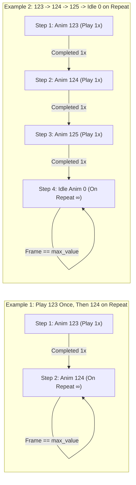

# Animation Linked Lists & Sequencer Window

## 📖 Overview
Introduce a dedicated **Animation Links / Sequencer Window** with persistent storage that enables users to create, name, edit, save, and play **Animation Linked Lists** (multi-step animation chains). Instead of only looping a single animation indefinitely, users can link multiple animations in sequence—for example, playing animation `123` once and automatically transitioning to animation `124` on repeat, or playing a multi-stage chain (`123` $\rightarrow$ `124` $\rightarrow$ `125`) before automatically returning to the idle animation (`0`) on repeat.

## 🎯 Goals & Use Cases
- **Goal 1 (Chained Animation Playback):** Enable automatic, frame-accurate transitions from one animation to the next once an animation completes a specified number of playback cycles (default `1` time), ending either in a repeating loop of a target animation or returning to idle animation `0` on repeat.
- **Goal 2 (Named & Reusable Linked Lists):** Allow users to organize and name custom animation chains (e.g., `"Sit to Wag Loop"`, `"Backflip Combo to Idle"`, `"Sleep Transition"`) so complex behaviors can be replayed with a single click.
- **Goal 3 (Dedicated Window & Persistent Storage):** Provide a separate manager/editor window (`Window` / dialog) to build and manage animation linked lists, and persist all named lists to `user://animation_links.json` across sessions.
- **Use Case A (Transition into Loop):** A user wants to preview an introductory transition animation followed by a continuous loop—e.g., once animation `123` has played `1` time, automatically switch to animation `124` on repeat (`123 [1x] -> 124 [Repeat]`).
- **Use Case B (Multi-Animation Action Chain Returning to Idle):** A user wants to preview a full trick or behavior sequence—when animation `123` finishes playing, play animation `124`, then play animation `125`, and finally return to idle animation `0` on repeat (`123 [1x] -> 124 [1x] -> 125 [1x] -> 0 [Repeat]`).
- **Use Case C (Desktop Pet Behavior Prototyping):** A developer or hexer builds and names reusable behavior chains (such as `"Greeting"`, `"Eat & Lick"`, or `"Pounce Combo"`) that remain saved the next time LnzLive is launched.

## 👥 Target Audience / User Roles
- **Petz Hexers / Breed Creators:** Users inspecting how ball positions, addballs, linez, and paintballz transition across consecutive animations and return to the standing idle pose (`Anim 0`).
- **Desktop Pet Designers / Animators:** Users authoring named behavior sequences and state transitions built from `.bhd`/`.bdt` animation indices.

## ⚙️ Functional Requirements
- [ ] **Requirement 1 (Animation Linked List Data Model):** Each named Animation Linked List must store:
  - `name` (`String`): Unique, user-editable display name for the linked list.
  - `steps` (`Array[Dictionary]`): Ordered list of animation links, where each step defines:
    - `anim_index` (`int`): The animation index to play (e.g., `123`, `124`, `125`, `0`).
    - `play_count` (`int`, default `1`): How many full times the animation plays before advancing to the next link.
    - `repeat_forever` (`bool`, default `false`): Whether playback stays on this step repeating indefinitely (used for terminal looping animations such as `124` on repeat or idle `0` on repeat).
  - `end_behavior` (`String` / `Enum`): Configurable fallback behavior after the last non-repeating step finishes:
    - **Return to Idle (`Anim 0`) on Repeat** (plays animation `0` in an infinite loop, or explicitly appends `0 [Repeat]`).
    - **Repeat Final Step** (loops the last animation in the list indefinitely).
    - **Loop Entire Linked List** (restarts the linked list from step 0).
    - **Stop Playback** (halts the playback timer at the last frame).
- [ ] **Requirement 2 (Separate Management & Editor Window):** Provide a separate window (`AnimLinksWindow`) accessible from the 3D pet view top toolbar (e.g., an `"Anim Links..."` button next to `AnimPicker`) and/or the `ToolsMenu`.
- [ ] **Requirement 3 (Naming & CRUD Operations):** Inside the separate window, users must be able to:
  - Create a new named Animation Linked List.
  - Rename an existing Animation Linked List.
  - Duplicate or delete an existing Animation Linked List.
  - Add, remove, and reorder (`Move Up` / `Move Down`) individual animation steps within the selected linked list.
  - Quick-append a `"Return to Idle (Anim 0 on Repeat)"` terminal step or set the list's end behavior.
- [ ] **Requirement 4 (Sequence Playback & Frame Transitions):**
  - When a linked list is played, the sequencer loads step `0`'s animation via `dog_generator.set_animation(anim_index)`, resets `FrameSlider` to `0`, and ensures the playback `Timer` is running.
  - When `FrameSlider` reaches `max_value` (the final frame of the current animation):
    - If the current step has `repeat_forever == true`, `FrameSlider` wraps to `0` and continues repeating that animation indefinitely.
    - Otherwise, the sequencer increments the completed cycle count for the current step. If `current_cycle < play_count`, it replays the current animation from frame `0`; once `current_cycle >= play_count`, it immediately transitions to the next linked step (`step_index + 1`).
    - When all steps have completed, the sequencer applies the list's `end_behavior` (e.g., switching to idle animation `0` on repeat).
- [ ] **Requirement 5 (Toolbar & UI Synchronization):**
  - During linked list playback, `AnimPicker` and `FrameSlider` must dynamically update to reflect the currently active animation index and frame, and the active step in the `AnimLinksWindow` must be visually highlighted.
  - Manually selecting an animation from `AnimPicker` while a linked list is active must cleanly exit sequence mode and revert to standard single-animation playback.
- [ ] **Requirement 6 (Species Bounds Handling):** If a linked list contains an animation index outside the range of the currently loaded species (`0 .. num_of_animations - 1`, e.g., switching from Catz with 493 animations to Dogz with 445 animations), out-of-range steps must either clamp to `0` (idle) or be skipped with a non-blocking warning indicator in the UI.
- [ ] **Requirement 7 (Persistence):** All named Animation Linked Lists must be automatically saved to and loaded from `user://animation_links.json` so user-defined sequences persist across application restarts.

## 🎨 UI/UX Design & Interactions
- **Entry Point:**
  - A `"Links..."` button (and optional quick-select sequence `OptionButton`) placed in the top toolbar inside `PetViewContainer/VBoxContainer/HBoxContainer` adjacent to `AnimPicker` and `Play`.
- **Separate Window (`AnimLinksWindow` — Godot `Window`):**
  - Opens as an independent, resizable sub-window (`popup_centered()`) so users can keep it open alongside the 3D Pet View while testing chains.
  - **Left Panel — Saved Animation Linked Lists:**
    - `ItemList` displaying all saved named linked lists (e.g., `"123 -> 124 Repeat"`, `"123-124-125 -> Idle 0"`).
    - Action bar with **`+ New`**, **`Rename`**, **`Duplicate`**, and **`Delete`** buttons.
  - **Right Panel — Linked List Chain Editor:**
    - **Header:** Editable `LineEdit` for the linked list's name and a summary preview badge (e.g., `Anim 123 (1x) → Anim 124 (1x) → Anim 125 (1x) → Anim 0 (Repeat)`).
    - **Steps List (`VBoxContainer` inside `ScrollContainer` or `Tree`):** Each row represents one link in the chain and includes:
      - Step number & active playback indicator (`▶`).
      - **Animation Selector** (`SpinBox` / `OptionButton` synced with valid animation indices `0 .. N-1`).
      - **Mode / Count Controls:** Toggle or dropdown between `Play N times` (`SpinBox` min `1`, default `1`) and `On Repeat (∞)`.
      - **Reorder / Delete Buttons:** `↑`, `↓`, and `✕`.
    - **Add Step Controls:**
      - **`+ Add Animation Link`** button (appends a new step before any terminal repeat step).
      - **`+ Add Return to Idle (Anim 0 Repeat)`** shortcut button (or **End Behavior** dropdown: `Return to Idle (Anim 0) on Repeat`, `Repeat Last Animation`, `Loop Sequence`, `Stop`).
    - **Playback Footer:**
      - **`▶ Play Linked List`** / **`⏹ Stop`** button and live status label (`"Playing Step 2/4: Anim 124 (1/1)"`).



## 💻 Technical Details
- **Scene Modifications ([`src/scenes/editor/editor.tscn`](../../src/scenes/editor/editor.tscn)):**
  - Add an `AnimLinksButton` (`Button`, text `"Links..."`) to `SceneRoot/HSplitContainer/HSplitContainer/PetViewContainer/VBoxContainer/HBoxContainer`.
  - Add a new `Window` node `AnimLinksWindow` under `Root/SceneRoot` (similar to `RecolorPopup` and `Popup`) or instantiate a dedicated scene `src/scenes/editor/AnimLinksWindow.tscn`.
- **Sequencer & Window Scripts:**
  - Create `src/scenes/editor/AnimLinksWindow.gd` (and optional row component `src/scenes/editor/AnimLinkStepRow.tscn` / `.gd`) to manage the UI state, CRUD operations, and active sequence execution.
  - Create a data/persistence helper or manage serialization within `AnimLinksWindow.gd` using `FileAccess` and `JSON`:
    - Save path: `user://animation_links.json`.
    - Schema example:
      ```json
      {
        "version": 1,
        "lists": [
          {
            "name": "123 to 124 Repeat",
            "end_behavior": "repeat_last",
            "steps": [
              { "anim_index": 123, "play_count": 1, "repeat_forever": false },
              { "anim_index": 124, "play_count": 1, "repeat_forever": true }
            ]
          },
          {
            "name": "123-124-125 to Idle",
            "end_behavior": "return_to_idle_repeat",
            "steps": [
              { "anim_index": 123, "play_count": 1, "repeat_forever": false },
              { "anim_index": 124, "play_count": 1, "repeat_forever": false },
              { "anim_index": 125, "play_count": 1, "repeat_forever": false },
              { "anim_index": 0, "play_count": 1, "repeat_forever": true }
            ]
          }
        ]
      }
      ```
- **Playback Hook ([`src/scenes/editor/FrameSlider.gd`](../../src/scenes/editor/FrameSlider.gd), [`src/scenes/editor/PlayButton.gd`](../../src/scenes/editor/PlayButton.gd), [`src/scenes/dog_generator.gd`](../../src/scenes/dog_generator.gd)):**
  - Update `FrameSlider.gd` to emit a signal `animation_finished_cycle` when `_on_Timer_timeout()` reaches `value == max_value` before wrapping to `0`:
    ```gdscript
    signal animation_finished_cycle

    func _on_Timer_timeout():
        if value == max_value:
            emit_signal("animation_finished_cycle")
        else:
            value += 1
    ```
  - When no linked list sequence is active, `FrameSlider` wraps `value = 0` as before.
  - When a linked list sequence is active in `AnimLinksWindow`, `_on_FrameSlider_animation_finished_cycle()` checks whether the current step should repeat or advance to the next linked animation via `dog_generator.set_animation(next_anim_index)` and `AnimPicker.select(next_anim_index)`.

## 🧪 Testing Plan
- **Scenario 1 (123 Once $\rightarrow$ 124 on Repeat):**
  - Create a named list `"Test 123 to 124"` with Step 1 = `Anim 123 (1x)` and Step 2 = `Anim 124 (Repeat)`.
  - Click **Play Linked List** and verify the pet plays all frames of animation `123` exactly once, then automatically switches to animation `124` and loops animation `124` indefinitely.
- **Scenario 2 (123 $\rightarrow$ 124 $\rightarrow$ 125 $\rightarrow$ Idle 0 on Repeat):**
  - Create a named list `"Combo to Idle"` with `Anim 123 (1x)` $\rightarrow$ `Anim 124 (1x)` $\rightarrow$ `Anim 125 (1x)` $\rightarrow$ `Anim 0 (Repeat)`.
  - Verify each animation plays through its full frame range in order and then settles into idle animation `0` on continuous repeat.
- **Persistence Verification:**
  - Create, name, and modify multiple animation linked lists, close the application, relaunch LnzLive, open the **Animation Links** window, and verify all named lists and their steps are restored from `user://animation_links.json`.
- **Manual Override & Edge Cases:**
  - While a sequence is playing, manually pick an animation in `AnimPicker` and confirm sequence mode disengages cleanly.
  - Test an empty list, a single-step list, and loading a species with fewer animations than an index in a saved list.

## 🔗 Related Resources
- [`src/scenes/editor/editor.tscn`](../../src/scenes/editor/editor.tscn)
- [`src/scenes/dog_generator.gd`](../../src/scenes/dog_generator.gd)
- [`src/scenes/editor/AnimPicker.gd`](../../src/scenes/editor/AnimPicker.gd)
- [`src/scenes/editor/FrameSlider.gd`](../../src/scenes/editor/FrameSlider.gd)
- [`src/scenes/editor/PlayButton.gd`](../../src/scenes/editor/PlayButton.gd)
- [`doc/features/implemented/Animation-Selection-Dropdown.md`](../implemented/Animation-Selection-Dropdown.md)
