# Godot Project Directory Reorganization & Standardization

## 📖 Overview
Reorganize the files and directories within [`src/`](../../../src/) (and clean up root repository clutter) to comply with official [Godot 4 Project Organization Best Practices](https://docs.godotengine.org/en/stable/tutorials/best_practices/project_organization.html) and the [Godot File & Naming Style Guide](https://docs.godotengine.org/en/stable/tutorials/scripting/gdscript/gdscript_styleguide.html#naming-conventions).

Currently, the `src/` directory exhibits several structural issues inherited from the original Godot 3 prototype: 3D scenes (`Ball.tscn`, `Line.tscn`, `Paintball.tscn`) and generic resources (`new_dynamicfontdata.tres`, `default_env.tres`) sit directly in the `src/` root; a UI scene (`RecolorLine.tscn`) lives inside `src/data_classes/`; scripts and scenes use inconsistent `PascalCase` and `snake_case` naming; 21 example `.lnz` files and `DroidSans.ttf` sit loose in `src/resources/`; and obsolete web exports (`src/export/`) and binary archives (`src/engine/godot.zip`) reside inside `res://` where Godot scans them on startup. This feature defines a clean, standardized directory hierarchy and step-by-step migration plan.

## 🎯 Goals & Use Cases
- **Goal 1 (Compliance with Official Godot 4 Standards):** Adopt Godot's recommended `snake_case` file and folder naming conventions (or coordinate directly with the C# `PascalCase` structure if executed together with [`GDScript-to-CSharp-Migration.md`](GDScript-to-CSharp-Migration.md)), co-locate related scenes and scripts by domain, and upgrade remaining legacy `format=2` scenes to Godot 4 `format=3`.
- **Goal 2 (Eliminate Root & `res://` Clutter):** Move all scenes, fonts, environments, and documentation images out of `src/` root into dedicated subdirectories, and remove or relocate non-project artifacts (`src/export/`, `src/engine/godot.zip`, unused `src/scripts/TextEdit.gd`).
- **Goal 3 (Structured Asset Hierarchy):** Organize `src/resources/` (or `src/assets/`) into clear domain subfolders (`pets/`, `animations/`, `textures/`, `palettes/`, `fonts/`, `themes/`) and protect raw binary data directories from unnecessary Godot importer overhead where appropriate.
- **Goal 4 (Zero Broken References):** Update all `res://` paths in `project.godot`, `.tscn` scene files, `preload()`/`load()` calls, and `DirAccess` runtime scanners (`FileTree.gd`, `bhd_parser.gd`, `bdt_parser.gd`, `petz_texture_loader.gd`) so the application runs identically with zero missing resource warnings.
- **Use Case A (Onboarding & Navigation):** A developer opening the project in the Godot 4 Editor `FileSystem` dock immediately finds scenes, scripts, shaders, and assets grouped logically without scrolling past loose root files or legacy HTML5 build outputs.
- **Use Case B (CI/CD & Export Cleanliness):** Automated desktop builds via `fgvm export` ([`CI-CD-GitHub-Actions-and-GitLab-Pipelines.md`](CI-CD-GitHub-Actions-and-GitLab-Pipelines.md)) package only required runtime assets without bundling `src/engine/godot.zip` or `src/export/*.pck`.

## 👥 Target Audience / User Roles
- **Developers & Maintainers:** Contributors navigating the Godot `FileSystem` dock, adding new scenes/scripts/themes, and maintaining CI/CD build pipelines.

---

## 🔍 Audit of Current Directory Issues

| Issue Category | Current Location(s) | Problem Against Godot Standards |
| :--- | :--- | :--- |
| **Loose Scenes in `res://` Root** | `src/Ball.tscn`, `src/Line.tscn`, `src/Paintball.tscn` | Root `res://` should only contain `project.godot`, project icon, and top-level folders. |
| **UI Scene Inside Data Layer** | `src/data_classes/RecolorLine.tscn` | A UI `HBoxContainer` scene is stored inside the data/parser class directory instead of the editor UI directory. |
| **Generic / Unsorted Root Resources** | `src/new_dynamicfontdata.tres`, `src/default_env.tres`, `src/screenshot.png` | Auto-generated Godot 3 default filenames (`new_dynamicfontdata.tres`) and README screenshots sitting in `res://` root. |
| **Inconsistent File Naming (`PascalCase` vs `snake_case`)** | `AnimPicker.gd`, `FileTree.gd`, `Ball.gd` vs `dog_generator.gd`, `unhandled_input_handler.gd`, `bhd_parser.gd` | Godot's official style guide mandates `snake_case` for all folder, scene (`.tscn`), script (`.gd`), and resource (`.tres`) filenames to avoid case-sensitivity bugs across Windows and Linux. |
| **Split Scene & Script Locations** | `src/Ball.tscn` $\leftrightarrow$ `src/scripts/Ball.gd`; `src/scenes/dog_generator.gd` (no `.tscn`) | Primitive scenes are in `src/`, their scripts are in `src/scripts/`, while `dog_generator.gd` is in `src/scenes/` and UI scripts are in `src/scenes/editor/`. |
| **Dead / Legacy Scripts & Format=2 Scenes** | `src/scripts/TextEdit.gd`; `Ball.tscn`, `Line.tscn`, `Paintball.tscn`, `RecolorLine.tscn` | `src/scripts/TextEdit.gd` (25 lines) is completely unused (superseded by `LnzTextEdit.gd`). Four `.tscn` files still use legacy Godot 3 `[gd_scene format=2]`. |
| **Unstructured `src/resources/` Root** | `src/resources/*.lnz` (21 files), `src/resources/DroidSans.ttf`, `src/resources/textures/petzpalette.png` | Example `.lnz` files and font files are mixed directly in `src/resources/`; the master color palette `petzpalette.png` is mixed inside `textures/` alongside `.bmp` patterns. |
| **Build & Engine Binaries Inside `res://`** | `src/export/*` (`index.wasm`, `index202204081810.pck`, etc.), `src/engine/godot.zip` | Legacy Godot 3 WebGL build artifacts and a zipped engine archive sit inside `src/`, causing Godot to scan/import them unless `.gdignore` is present and violating [ADR-0001](../../adr/0001-desktop-application-scope.md). |

---

## ⚙️ Functional Requirements
- [ ] **Requirement 1 (Purge / Relocate Non-Project Artifacts from `src/`):**
  - Delete the obsolete Godot 3 HTML5 export directory `src/export/` (superseded by native desktop builds per [ADR-0001](../../adr/0001-desktop-application-scope.md)) and remove `src/engine/godot.zip` (managed via `.fgvm-version` and FGVM).
  - Move `src/screenshot.png` to the top-level repository [`img/`](../../../img/) directory (and delete `src/screenshot.png.import`), updating `README.md` image links accordingly.
  - Delete the unused legacy script [`src/scripts/TextEdit.gd`](../../../src/scripts/TextEdit.gd) (and `TextEdit.gd.uid`).
- [ ] **Requirement 2 (Standardize Directory Hierarchy under `src/`):**
  - Organize `src/` into clear, domain-driven top-level directories following Godot 4 best practices:
    - `src/autoload/` (or `src/core/`): Global autoload singletons (`key_balls_data.gd`).
    - `src/models/`: Pure data structures and enums (`ball_data.gd`, `addball_data.gd`, `line_data.gd`, `paintball_data.gd`, `section_enum.gd`).
    - `src/parsers/`: File format parsers and loaders (`lnz_parser.gd`, `bhd_parser.gd`, `bdt_parser.gd`, `petz_texture_loader.gd`).
    - `src/pet_renderer/` (or `src/scenes/pet/`): Co-located 3D pet generator, primitive scenes, controllers, and shaders (`dog_generator.gd`, `ball.tscn` + `ball.gd`, `line.tscn` + `line.gd`, `paintball.tscn` + `paintball.gd`, `rotator.gd`, and `shaders/`).
    - `src/editor/` (or `src/scenes/editor/`): Co-located main editor scene, UI sub-scenes (`recolor_line.tscn`), and UI controller scripts.
    - `src/assets/` (or `src/resources/`): Structured static assets divided into `examples/` (`.lnz`), `animations/` (`.bhd`/`.bdt`), `textures/` (`.bmp`), `palettes/` (`petzpalette.png`), `fonts/` (`DroidSans.ttf`, `droid_sans_font.tres`), and `environment/` (`default_env.tres`).
- [ ] **Requirement 3 (Standardize File Naming to `snake_case`):**
  - Rename all `.tscn`, `.gd`, and `.tres` files to `snake_case` per the official Godot style guide (e.g., `Ball.tscn` $\rightarrow$ `ball.tscn`, `AnimPicker.gd` $\rightarrow$ `anim_picker.gd`, `new_dynamicfontdata.tres` $\rightarrow$ `droid_sans_font.tres`).
  - *Note on C# Migration Alignment:* If this reorganization is executed immediately prior to or as part of [`GDScript-to-CSharp-Migration.md`](GDScript-to-CSharp-Migration.md), scripts and scenes can instead adopt the C# `PascalCase` convention specified in that feature document. Both options are detailed in the **Technical Details** section below.
- [ ] **Requirement 4 (Upgrade Legacy Scene Formats):**
  - Re-save `ball.tscn`, `line.tscn`, `paintball.tscn`, and `recolor_line.tscn` in Godot 4 `[gd_scene format=3]` format with valid `uid://` identifiers.
- [ ] **Requirement 5 (Update All Resource & Runtime Directory Paths):**
  - Update `run/main_scene`, `KeyBallsData` autoload, and `default_environment` paths in [`src/project.godot`](../../../src/project.godot).
  - Update all `ExtResource` paths in `.tscn` and `.tres` files.
  - Update all `preload()` and `DirAccess` / `FileAccess` paths in scripts (`dog_generator.gd`, `file_tree.gd`, `bhd_parser.gd`, `bdt_parser.gd`, `petz_texture_loader.gd`).
- [ ] **Requirement 6 (Export & Ignore Hygiene):**
  - Ensure desktop build outputs target a directory outside `src/` (e.g., `build/` at the repository root, or `src/build/` containing a `.gdignore` file so Godot never imports compiled executables or `.pck` archives).

---

## 🎨 UI/UX Design & Interactions
- **No End-User Visual Changes:** The reorganization is purely structural and internal to the repository and Godot Editor `FileSystem` dock.
- **Godot Editor Experience:** Opening the project in Godot 4 presents a clean, self-documenting folder tree with zero root clutter.

---

## 💻 Technical Details

### 1. Current vs. Target Directory Structure (`src/`)

```mermaid
flowchart LR
    subgraph Current ["Current Structure (Unstandardized)"]
        direction TB
        C1["src/ (Root Clutter)\n├── Ball.tscn, Line.tscn, Paintball.tscn\n├── default_env.tres, new_dynamicfontdata.tres\n└── screenshot.png, GUIDE.md, README.md"]
        C2["src/data_classes/\n├── *.gd (Models & Parsers mixed)\n└── RecolorLine.tscn (UI Scene!)"]
        C3["src/scenes/ & src/scripts/\n├── dog_generator.gd\n├── editor/ (Mixed PascalCase & snake_case)\n└── scripts/ (Ball.gd, Line.gd, unused TextEdit.gd)"]
        C4["src/resources/\n├── *.lnz (21 loose files) + DroidSans.ttf\n├── animations/ (*.bhd, *.bdt)\n└── textures/ (*.bmp + petzpalette.png)"]
        C5["src/export/ & src/engine/\n└── Legacy WebGL build & godot.zip"]
    end

    subgraph Target ["Target Godot 4 Structure (Standardized)"]
        direction TB
        T1["src/\n├── project.godot\n└── icon.png"]
        T2["src/core/\n├── autoload/key_balls_data.gd\n├── models/ (ball_data.gd, line_data.gd, ...)\n└── parsers/ (lnz_parser.gd, bhd_parser.gd, ...)"]
        T3["src/scenes/\n├── pet/ (dog_generator.gd, ball.tscn/.gd, line.tscn/.gd, paintball.tscn/.gd, rotator.gd)\n└── editor/ (editor.tscn, recolor_line.tscn, anim_picker.gd, file_tree.gd, ...)"]
        T4["src/shaders/\n└── ball.tres, line.tres, paintball.tres"]
        T5["src/resources/\n├── examples/ (*.lnz)\n├── animations/ (*.bhd, *.bdt)\n├── textures/ (*.bmp)\n├── palettes/ (petzpalette.png)\n├── fonts/ (DroidSans.ttf, droid_sans_font.tres)\n└── environment/ (default_env.tres)"]
    end

    Current ==>|"Reorganize & Standardize"| Target
```



### 2. Proposed Standardized Directory Tree

```text
├── build/                                    # Desktop export output directory (outside res://, gitignored)
├── doc/                                      # Documentation, ADRs, format specs, and feature docs
│   └── GUIDE.md                              # Moved from src/GUIDE.md (or linked from root)
├── img/                                      # Repository screenshots and documentation media
│   └── screenshot.png                        # Moved from src/screenshot.png
├── src/                                      # Clean Godot 4 project root (res://)
│   ├── .fgvm-version
│   ├── .gitignore
│   ├── icon.png
│   ├── project.godot
│   ├── core/
│   │   ├── autoload/
│   │   │   └── key_balls_data.gd
│   │   ├── models/
│   │   │   ├── addball_data.gd
│   │   │   ├── ball_data.gd
│   │   │   ├── line_data.gd
│   │   │   ├── paintball_data.gd
│   │   │   └── section_enum.gd
│   │   └── parsers/
│   │       ├── bdt_parser.gd
│   │       ├── bhd_parser.gd
│   │       ├── lnz_parser.gd
│   │       └── petz_texture_loader.gd
│   ├── scenes/
│   │   ├── pet/                              # Co-located 3D pet scenes & scripts
│   │   │   ├── ball.gd
│   │   │   ├── ball.tscn
│   │   │   ├── dog_generator.gd
│   │   │   ├── line.gd
│   │   │   ├── line.tscn
│   │   │   ├── paintball.gd
│   │   │   ├── paintball.tscn
│   │   │   └── rotator.gd
│   │   └── editor/                           # Co-located Editor UI scenes & scripts
│   │       ├── anim_picker.gd
│   │       ├── editor.tscn
│   │       ├── file_tree.gd
│   │       ├── fps_label.gd
│   │       ├── frame_slider.gd
│   │       ├── lnz_text_edit.gd
│   │       ├── pet_view_container.gd
│   │       ├── play_button.gd
│   │       ├── recolor_line.tscn
│   │       ├── tools_menu.gd
│   │       └── unhandled_input_handler.gd
│   ├── shaders/
│   │   ├── ball.tres
│   │   ├── line.tres
│   │   └── paintball.tres
│   └── resources/
│       ├── animations/                       # CAT.bhd, DOG.bhd, CAT*.bdt, DOG*.bdt
│       ├── environment/
│       │   └── default_env.tres
│       ├── examples/                         # All 21 bundled example .lnz files
│       ├── fonts/
│       │   ├── DroidSans.ttf
│       │   └── droid_sans_font.tres          # Renamed from new_dynamicfontdata.tres
│       ├── palettes/
│       │   └── petzpalette.png               # Separated from .bmp surface textures
│       └── textures/                         # Bundled 8-bit .bmp fur/clothing textures
└── README.md
```

> [!NOTE]
> **Coordination with C# Migration ([`GDScript-to-CSharp-Migration.md`](GDScript-to-CSharp-Migration.md)):**  
> Godot's official style guide specifies `snake_case` for GDScript projects (`ball.gd`, `anim_picker.gd`) and `PascalCase` for C# projects (`Ball.cs`, `AnimPicker.cs`) to match `.NET` class and namespace conventions. If the team plans to execute the C# migration immediately, the folder structure in `src/` can directly adopt the C# namespace layout (`Core/`, `Models/`, `Parsers/`, `Rendering/`, `UI/`, `Scenes/`) while applying the exact same `resources/` cleanup (`examples/`, `palettes/`, `fonts/`, `environment/`) and `export/`/`engine/` removal defined here.

### 3. Complete File Relocation & Path Update Reference

| Current Path | Action / Target Path | Code / Scene References to Update |
| :--- | :--- | :--- |
| `src/export/*` | **Delete** | Obsolete Godot 3 WebGL export ([ADR-0001](../../adr/0001-desktop-application-scope.md)) |
| `src/engine/godot.zip` | **Delete** | Managed by FGVM (`.fgvm-version`) |
| `src/scripts/TextEdit.gd` | **Delete** | Dead code (unreferenced anywhere in project) |
| `src/screenshot.png` | **Move** $\rightarrow$ `img/screenshot.png` | Update [`README.md`](../../../README.md) image link |
| `src/default_env.tres` | **Move** $\rightarrow$ `src/resources/environment/default_env.tres` | Update `environment/defaults/default_environment` in `src/project.godot` |
| `src/new_dynamicfontdata.tres` | **Move & Rename** $\rightarrow$ `src/resources/fonts/droid_sans_font.tres` | Update `ExtResource("8")` in `editor.tscn` |
| `src/resources/DroidSans.ttf` | **Move** $\rightarrow$ `src/resources/fonts/DroidSans.ttf` | Update `font_path` in `droid_sans_font.tres` |
| `src/resources/*.lnz` | **Move** $\rightarrow$ `src/resources/examples/*.lnz` | Update `example_file_location = "res://resources/examples/"` in `file_tree.gd` |
| `src/resources/textures/petzpalette.png` | **Move** $\rightarrow$ `src/resources/palettes/petzpalette.png` | Update `ExtResource` path in `ball.tres`, `line.tres`, and `paintball.tres` |
| `src/Ball.tscn` & `src/scripts/Ball.gd` | **Move & Rename** $\rightarrow$ `src/scenes/pet/ball.tscn` & `ball.gd` | Update `preload("res://scenes/pet/ball.tscn")` in `dog_generator.gd` and script ref in `ball.tscn` |
| `src/Line.tscn` & `src/scripts/Line.gd` | **Move & Rename** $\rightarrow$ `src/scenes/pet/line.tscn` & `line.gd` | Update `preload("res://scenes/pet/line.tscn")` in `dog_generator.gd` and script ref in `line.tscn` |
| `src/Paintball.tscn` & `src/scripts/Paintball.gd` | **Move & Rename** $\rightarrow$ `src/scenes/pet/paintball.tscn` & `paintball.gd` | Update `preload("res://scenes/pet/paintball.tscn")` in `dog_generator.gd` and script ref in `paintball.tscn` |
| `src/scripts/rotator.gd` | **Move** $\rightarrow$ `src/scenes/pet/rotator.gd` | Keep co-located with 3D pet viewport/camera scripts |
| `src/scenes/dog_generator.gd` | **Move** $\rightarrow$ `src/scenes/pet/dog_generator.gd` | Update `ExtResource("3")` in `editor.tscn` |
| `src/data_classes/RecolorLine.tscn` | **Move & Rename** $\rightarrow$ `src/scenes/editor/recolor_line.tscn` | Update `ExtResource("11")` in `editor.tscn` |
| `src/data_classes/key_balls_data.gd` | **Move** $\rightarrow$ `src/core/autoload/key_balls_data.gd` | Update `[autoload]` `KeyBallsData` in `src/project.godot` |
| `src/data_classes/*_data.gd`, `section_enum.gd` | **Move** $\rightarrow$ `src/core/models/` | Global `class_name` declarations resolve automatically across `res://` |
| `src/data_classes/*_parser.gd`, `petz_texture_loader.gd` | **Move** $\rightarrow$ `src/core/parsers/` | Update `preload("res://core/parsers/petz_texture_loader.gd")` in `dog_generator.gd` and `file_tree.gd` |
| `src/scenes/editor/*.gd` | **Rename** to `snake_case.gd` | Update `ExtResource` script paths in `editor.tscn` |

---

## 🧪 Testing Plan
- **Clean Import & Zero Warnings Check:**
  - Delete `src/.godot/` cache folder and open `src/project.godot` (or run `godot --headless --import`). Verify that Godot rebuilds the `.godot` import cache cleanly with zero missing resource (`ext_resource` / `uid://`) errors or script parse errors.
- **Example Pet & Texture Loading Verification:**
  - Launch the application and verify `FileTree` populates the `Examples` list from `res://resources/examples/`, `Local Storage` from `user://resources/`, and `Local Textures` from `user://resources/textures/`.
- **3D Rendering & Shader Palette Verification:**
  - Load both Dogz (`dachsund.lnz`) and Catz (`catz_base.lnz`) examples and confirm that `ball.tres`, `line.tres`, and `paintball.tres` properly sample `res://resources/palettes/petzpalette.png` and `res://resources/textures/*.bmp`.
- **UI & Tools Verification:**
  - Open `RecolorPopup` (`Color Swap`) to confirm `recolor_line.tscn` instantiates all 9 rows properly, and test `Popup` (Help window) and `RenameDialog` to confirm `droid_sans_font.tres` renders without missing font fallback warnings.

## 🔗 Related Resources
- [Godot 4 Official Docs: Project Organization Best Practices](https://docs.godotengine.org/en/stable/tutorials/best_practices/project_organization.html)
- [Godot 4 Official Docs: GDScript Style Guide — Naming Conventions](https://docs.godotengine.org/en/stable/tutorials/scripting/gdscript/gdscript_styleguide.html#naming-conventions)
- [`src/project.godot`](../../../src/project.godot)
- [`src/scenes/editor/editor.tscn`](../../../src/scenes/editor/editor.tscn)
- [`doc/features/review/GDScript-to-CSharp-Migration.md`](GDScript-to-CSharp-Migration.md)
- [`doc/adr/0001-desktop-application-scope.md`](../../adr/0001-desktop-application-scope.md)
