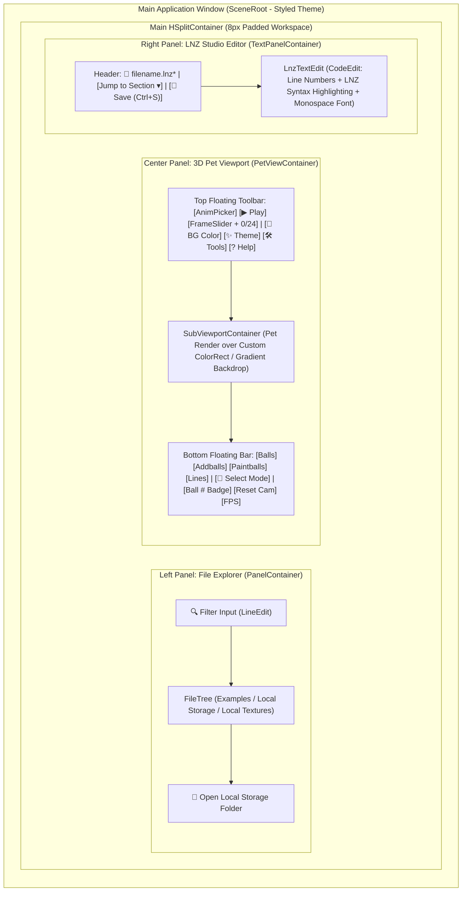

# Modern UI Overhaul & Theme System

## 📖 Overview
Overhaul the **LnzLive** desktop interface ([`src/scenes/editor/editor.tscn`](../../../src/scenes/editor/editor.tscn)) to replace the unstyled default Godot controls and hardcoded Windows 95 teal background (`Color(0, 0.5, 0.5, 1)` / `#008080`) with a cohesive, modern application UI. This feature introduces a centralized Godot 4 `Theme` architecture, multiple selectable **Style Proposals** (theme presets), interactive **3D viewport background color customization** (with quick swatches and a color picker), an upgraded **LNZ Code Editor** (`CodeEdit` with syntax highlighting and line numbers), and redesigned toolbars, sidebars, and modal dialogs.

## 🎯 Goals & Use Cases
- **Goal 1 (Modernized Visual Identity & Theme System):** Replace raw, unstyled Godot controls with a unified Godot `Theme` resource (`StyleBoxFlat` panels, subtle rounded corners, consistent padding, clear hover/focus states, and crisp UI/monospace typography).
- **Goal 2 (Customizable Viewport & UI Background Colors):** Replace the static `SceneRoot/ColorRect` (`#008080`) with a user-customizable 3D viewport backdrop supporting instant color picking, curated contrast swatches, and optional studio gradient/grid overlays.
- **Goal 3 (Curated Style Proposals / Theme Presets):** Support switchable visual style presets tailored to different workflows—ranging from a sleek dark 3D studio IDE to a cozy pastel Petz Workshop theme, a remastered classic teal theme, and a clean daylight studio theme.
- **Goal 4 (Improved Hexing Ergonomics & Visual Hierarchy):** Upgrade the raw `TextEdit` into a full `CodeEdit` with `.lnz` syntax highlighting and line numbers, organize the floating 3D viewport controls into a structured toolbar and status bar, and polish all popups (`ToolsMenu`, `RecolorPopup`, `ColorPopup`, `HeadMovePopup`, `RenameDialog`, `HelpPopup`).
- **Use Case A (Contrast Checking While Hexing):** A breed creator editing a dark-coated pet (`scottie.lnz`) or a white-coated pet (`snowball.lnz`) clicks a quick background swatch or uses the toolbar `ColorPickerButton` to switch the 3D viewport background from dark slate to warm cream, neutral 50% gray, or classic `#008080` teal to inspect dark/light ball outlines and fuzz accurately.
- **Use Case B (Clean Showcases & Screenshots):** A user preparing showcase screenshots or GIFs of their custom pet switches the viewport background to a clean pastel backdrop or a solid chroma-key color without editing scene files.
- **Use Case C (Extended Editing Comfort):** A user working on a multi-hour `.lnz` hexing session selects the **Modern Dark Studio** preset (or **Cozy Pastel Workshop** preset) and benefits from syntax-highlighted `[Section]` headers, visible line numbers, and a clear unsaved-changes (`*`) indicator.

## 👥 Target Audience / User Roles
- **Petz Hexers & Breed Creators:** Users who spend hours inspecting ball placements, color ramps, outlines, and fuzz in the 3D viewport alongside `.lnz` text files.
- **Desktop Pet Designers & Animators:** Users previewing animations and visual appearance across varied background colors and lighting contrasts.

---

## 🎨 Style Proposals

Below are four cohesive **Style Proposals** designed for LnzLive. The theme architecture can either adopt Proposal 1 as the default while offering the others as built-in switchable presets in a theme dropdown, or standardize on one selected direction after review.

### Proposal 1: "Modern Dark Studio" *(Recommended Default)*
> **Inspiration:** Blender 4.x, Blockbench, VS Code Dark+  
> **Design Rationale:** A low-eye-strain, neutral dark charcoal interface that recedes visually so the Petz 256-color palette (`petzpalette.png`), ball outlines, and pixel-art textures stand out with maximum clarity.

| Token / Element | Hex Color | Preview / Usage |
| :--- | :--- | :--- |
| **App Shell / Window Base** | `#181A1F` | Deep carbon background behind split containers |
| **Panel & Sidebar Surface** | `#21252B` | `FileTree` sidebar, `LnzTextEdit` background, dialog bodies |
| **Elevated Control / Toolbar** | `#2C313A` | Top toolbar pills, buttons, dropdowns (`AnimPicker`), input fields |
| **3D Viewport Backdrop (Default)** | `#282C34` | Neutral dark slate (replaces `#008080`); optional radial vignette to `#1E222A` |
| **Primary Accent** | `#4D9DE0` | Active buttons (`Play` active), selected tree row, slider fill, focus ring |
| **Secondary / Highlight Accent** | `#56B6C2` | Active `Select` mode badge, hovered ball indicator |
| **Text (Primary / Muted)** | `#E6EDF3` / `#8B949E` | High-contrast crisp labels / secondary metadata (`FPS`, frame count) |
| **Borders & Splitters** | `#30363D` | `1px` subtle borders, `6px` corner radius on controls |

---

### Proposal 2: "Cozy Pastel Workshop" *(Warm & Playful)*
> **Inspiration:** Classic *Petz 4/5* Playscenes, cozy indie simulation UIs  
> **Design Rationale:** A warm, inviting aesthetic with soft cream panels, rounded pill buttons (`8px` radius), and a gentle sky-blue or warm-sand viewport background that feels like a modern virtual pet adoption center and studio.

| Token / Element | Hex Color | Preview / Usage |
| :--- | :--- | :--- |
| **App Shell / Window Base** | `#F4EFE6` | Warm oat / parchment shell |
| **Panel & Sidebar Surface** | `#FFFDF9` | Soft ivory surface for `FileTree` and `.lnz` editor |
| **Elevated Control / Toolbar** | `#EAE2D6` | Warm sand buttons, checkboxes, and toolbar containers |
| **3D Viewport Backdrop (Default)** | `#CFE8EF` | Soft pastel sky blue (or `#E8E0D5` warm studio floor) |
| **Primary Accent** | `#E07A5F` | Warm terracotta coral for primary actions (`Play`, `Save`) |
| **Secondary / Highlight Accent** | `#81B29A` | Soft sage green for active toggles (`Select` mode, visibility chips) |
| **Text (Primary / Muted)** | `#2F2D2E` / `#6E6A66` | Warm espresso primary text / muted taupe labels |
| **Borders & Splitters** | `#D8CFC2` | Soft warm border lines, `8px` corner radius |

---

### Proposal 3: "Neo-Retro 98 Remastered" *(Classic Petz / LNZ Pro Tribute)*
> **Inspiration:** Original LnzLive `#008080` Windows 95 desktop & classic Petz modding tools  
> **Design Rationale:** Preserves the iconic `#008080` teal viewport backdrop that veteran Petz hexers are accustomed to for judging outline contrast, while upgrading the surrounding chrome to a sleek slate-teal flat interface with crisp typography and structured toolbars.

| Token / Element | Hex Color | Preview / Usage |
| :--- | :--- | :--- |
| **App Shell / Window Base** | `#1B2B2E` | Deep dark teal-slate shell |
| **Panel & Sidebar Surface** | `#233438` | Rich dark slate for `FileTree` and `LnzTextEdit` |
| **Elevated Control / Toolbar** | `#2E4449` | Muted teal-gray controls and toolbar cards |
| **3D Viewport Backdrop (Default)** | `#008080` | Classic Windows 95 / LnzLive Teal (`Color(0, 0.5, 0.5, 1)`) |
| **Primary Accent** | `#26A69A` | Vibrant mint-teal accent for active controls and sliders |
| **Secondary / Highlight Accent** | `#FFCA28` | Classic warm amber for ball selection and `Select` mode |
| **Text (Primary / Muted)** | `#ECEFF1` / `#90A4AE` | Crisp ice-white text / muted blue-gray secondary labels |
| **Borders & Splitters** | `#3B555B` | `1px` crisp borders, `4px` corner radius |

---

### Proposal 4: "Clean Daylight Studio" *(Minimalist Light Mode)*
> **Inspiration:** Figma, Windows 11 Fluent Light, CAD inspection tools  
> **Design Rationale:** A bright, neutral-achromatic studio layout designed for daylight environments and zero color cast when comparing pet colors against the 256-color chart.

| Token / Element | Hex Color | Preview / Usage |
| :--- | :--- | :--- |
| **App Shell / Window Base** | `#F3F4F6` | Cool light gray application frame |
| **Panel & Sidebar Surface** | `#FFFFFF` | Pure white panels for file browser and code editor |
| **Elevated Control / Toolbar** | `#E5E7EB` | Subtle neutral gray buttons and inputs |
| **3D Viewport Backdrop (Default)** | `#D1D5DB` | Perceptually neutral middle-light studio gray |
| **Primary Accent** | `#2563EB` | Clean royal blue for active states and focus rings |
| **Secondary / Highlight Accent** | `#059669` | Emerald green for active selection state |
| **Text (Primary / Muted)** | `#111827` / `#6B7280` | Deep slate ink / neutral medium gray |
| **Borders & Splitters** | `#D1D5DB` | `1px` hairline dividers, `6px` corner radius |

---

## ⚙️ Functional Requirements
- [ ] **Requirement 1 (Centralized Godot 4 Theme & Preset Switcher):**
  - Create a modular Godot `Theme` resource (`res://resources/themes/editor_theme.tres` or dynamically generated theme builder) applied to `SceneRoot` so all child controls, popups, and sub-windows automatically inherit consistent styling.
  - Provide a **Theme Preset Selector** (`OptionButton` in the top header or `ToolsMenu`) allowing users to switch between *Modern Dark Studio*, *Cozy Pastel Workshop*, *Neo-Retro 98*, and *Clean Daylight Studio* at runtime.
- [ ] **Requirement 2 (Interactive 3D Viewport Background Customization):**
  - Add a **Background Color Control** to the 3D viewport toolbar:
    - A `ColorPickerButton` bound directly to `SceneRoot/ColorRect.color` for arbitrary custom background colors.
    - Quick-select preset swatches for instant 1-click contrast testing:
      - **Studio Dark** (`#282C34`)
      - **Neutral 50% Gray** (`#808080`)
      - **Classic Teal** (`#008080`)
      - **Warm Cream** (`#F4EFE6`)
      - **Chroma Green / Magenta** (`#00FF00` / `#FF00FF`)
  - Optionally support a toggleable subtle radial vignette or checkerboard/grid shader on the background `ColorRect` to ground the pet in 3D space.
- [ ] **Requirement 3 (Modernized 3D Viewport Top & Bottom Overlay Bars):**
  - Replace the unstyled `HBoxContainer` and `HBoxContainer2` in `PetViewContainer` with two styled, semi-translucent floating toolbar panels (`PanelContainer` with `StyleBoxFlat`, `8px` padding, `6px` border radius):
    - **Top Transport & Animation Bar:**
      - `AnimPicker` (`OptionButton` with `"Anim:"` prefix/label and clean minimum width).
      - `PlayButton` (`▶ Play` / `⏸ Pause` toggle button with distinct active accent styling).
      - `FrameSlider` (`HSlider` with custom track/grabber styling) paired with a live **`FrameCounterLabel`** (e.g., `Frame: 0 / 24`).
      - **Viewport Background Swatch / `ColorPickerButton`** and **Theme Preset** button.
      - **`Tools` Button** (opens `ToolsMenu` via click in addition to `Ctrl+Space`) and **`?` Help Button** (opens the Controls/Guide window, wiring up the existing `_on_HelpButton_pressed()` method in `PetViewContainer.gd`).
    - **Bottom Viewport Overlay / Status Bar:**
      - Compact pill-style toggle buttons or styled `CheckBox` chips for `Balls`, `Addballs`, `Paintballs`, and `Lines`.
      - Prominent **`Select Mode`** toggle button (`CheckButton` or accented toggle `Button`) with a status readout showing the currently hovered/selected ball (`"Hovered: Ball #24 (Head)"`) instead of an unstyled floating text label.
      - Right-aligned `FPSLabel` badge (`60 FPS`) and current camera zoom/reset button (`Reset View`).
- [ ] **Requirement 4 (File Browser Sidebar Improvements):**
  - Add a panel header above `FileTree` with a **Search / Filter `LineEdit`** (`"Filter pets & textures..."`) to filter items under `Examples`, `Local Storage`, and `Local Textures` in real time.
  - Style root category rows (`Examples`, `Local Storage`, `Local Textures`) with distinct section formatting and add a quick `"Open User Folder"` button (`OS.shell_open(ProjectSettings.globalize_path("user://"))`) so users can easily drop custom `.lnz` or `.bmp` files into local storage.
- [ ] **Requirement 5 (LNZ Code Editor Upgrade):**
  - Upgrade `LnzTextEdit` from a plain `TextEdit` to a Godot 4 `CodeEdit` (or configured `TextEdit` with `CodeHighlighter`):
    - Use a crisp monospace font for `.lnz` alignment and tabular numeric columns.
    - Enable **line numbers** (`gutters_draw_line_numbers = true`) and current-line highlighting.
    - Configure syntax highlighting for `[Section Headers]`, `;` and `#` comments, and numeric parameters.
  - Add an **Editor Header Bar** above `LnzTextEdit` displaying:
    - The currently loaded filename (e.g., `dachsund.lnz (Example)` or `user://resources/my_dog.lnz`).
    - An unsaved changes indicator (`● Modified`) when text is edited before `Ctrl+S`.
    - An explicit **`Save & Refresh (Ctrl+S)`** button and a **Section Jump Dropdown** (`[Ballz Info]`, `[Add Ball]`, `[Move]`, `[Project Ball]`, `[Linez]`, `[Paint Ballz]`) to jump directly to any `.lnz` section.
- [ ] **Requirement 6 (Polished Modal Dialogs & Tool Popups):**
  - Add descriptive field labels (`Base Color Index`, `Outline Color Index`, `X / Y / Z Offset`), margins, and titles to `ColorPopup`, `HeadMovePopup`, `RecolorPopup`, and `RenameDialog`.
  - Include a visual color swatch preview next to color index inputs in `ColorPopup` and `RecolorLine.tscn` (sampling `petzpalette.png` for indices `0–255` so users immediately see the color they typed!).
- [ ] **Requirement 7 (UI Preferences Persistence):**
  - Persist the user's selected theme preset, custom viewport background color, and visibility toggle states to `user://ui_settings.cfg` via `ConfigFile`, restoring them automatically on startup.

---

## 🎨 UI/UX Design & Interactions

### Proposed Layout Architecture

### Key UX Enhancements
1. **1-Click Background Color & Contrast Swatches:**
   - Located in the top-right of the 3D viewport toolbar. Clicking a preset dot immediately updates `SceneRoot/ColorRect.color`; clicking the custom swatch opens Godot's `ColorPicker` popup.
2. **Live Palette Swatch Preview in Color Tools:**
   - When opening `ColorPopup` or `RecolorPopup` (`Color Swap`), typing a Petz palette index (`0`–`255`) renders the exact RGB color from `petzpalette.png` in a small `16x16` `ColorRect` badge next to the `LineEdit`.
3. **Discoverable Tools & Help:**
   - New users no longer need to memorize `Ctrl+Space` to find the Tools menu or miss the disconnected `_on_HelpButton_pressed()` handler—dedicated **`Tools`** and **`?`** buttons sit right in the viewport toolbar.

---

## 💻 Technical Details
- **Scene Structure Updates ([`src/scenes/editor/editor.tscn`](../../../src/scenes/editor/editor.tscn)):**
  - Attach a master `Theme` resource (or `ThemeManager.gd` script on `SceneRoot`) that builds and applies `StyleBoxFlat` definitions for `PanelContainer`, `Button`, `OptionButton`, `LineEdit`, `CodeEdit`/`TextEdit`, `Tree`, `HSlider`, `PopupMenu`, and `Window`.
  - Update `SceneRoot/ColorRect` to be managed by `PetViewContainer.gd` (or `ThemeManager.gd`) so its `color` property updates when a theme preset or custom background color is selected.
  - Restructure `PetViewContainer/VBoxContainer` so `HBoxContainer` (top bar) and `HBoxContainer2` (bottom bar) are wrapped in styled `PanelContainer` nodes with `SizeFlags` keeping the 3D view unobstructed in the center.
  - Upgrade `LnzTextEdit` node type from `TextEdit` to `CodeEdit` (which inherits from `TextEdit` in Godot 4, preserving all existing `LnzTextEdit.gd` methods while unlocking `gutters_draw_line_numbers` and `CodeHighlighter`).
- **New / Updated Scripts:**
  - `ThemeManager.gd` (or `UIThemeController.gd`): Defines the 4 Style Proposal color dictionaries (`MODERN_DARK`, `COZY_PASTEL`, `NEO_RETRO_98`, `CLEAN_LIGHT`), generates the `StyleBoxFlat` theme overrides, updates `ColorRect.color` and `LnzTextEdit` syntax highlighter colors, and saves/loads `user://ui_settings.cfg`.
  - [`PetViewContainer.gd`](../../../src/scenes/editor/PetViewContainer.gd): Add handlers for the `ColorPickerButton` (`_on_bg_color_changed(color: Color)`), quick background swatches, camera reset (`camera_holder.rotation = Vector3.ZERO`, `camera.transform.origin = Vector3(0, 0, -1)`, `tex.scale = Vector2.ONE`), and connect the Help/Tools toolbar buttons.
  - [`LnzTextEdit.gd`](../../../src/scenes/editor/LnzTextEdit.gd): Configure `CodeHighlighter` rules for `.lnz` section headers (`[Ballz Info]`, `[Add Ball]`, etc.), comments (`;`, `#`), and dirty-state tracking (`text_changed` $\rightarrow$ header indicator, cleared on `file_saved`).

---

## 🧪 Testing Plan
- **Theme Switching Verification:**
  - Switch through all 4 Style Proposals (*Modern Dark Studio*, *Cozy Pastel Workshop*, *Neo-Retro 98*, *Clean Daylight Studio*) at runtime and verify that panels, buttons, `FileTree`, `LnzTextEdit` text/background contrast, and popup dialogs update cleanly with no unreadable text.
- **Viewport Background Color Customization:**
  - Select each quick-swatch preset and pick a custom color via `ColorPickerButton`. Verify that `SceneRoot/ColorRect` updates immediately behind the transparent `SubViewportContainer` without affecting the pet's 256-color palette rendering or nearest-neighbor pixel snapping.
- **Persistence Across Sessions:**
  - Select a non-default theme and custom viewport background color, close the app, relaunch, and verify `user://ui_settings.cfg` restores both settings automatically.
- **Editor & Toolbar Regressions:**
  - Verify that `Select` mode raycasting (`PetViewContainer.gd`), camera rotation/pan/zoom, `AnimPicker`, `FrameSlider`, `Ctrl+S` saving, `Ctrl+Q` ball flashing, and all `ToolsMenu` popups function identically with the new container padding and `CodeEdit` upgrade.

## 🔗 Related Resources
- [`src/scenes/editor/editor.tscn`](../../../src/scenes/editor/editor.tscn)
- [`src/scenes/editor/PetViewContainer.gd`](../../../src/scenes/editor/PetViewContainer.gd)
- [`src/scenes/editor/LnzTextEdit.gd`](../../../src/scenes/editor/LnzTextEdit.gd)
- [`src/scenes/editor/ToolsMenu.gd`](../../../src/scenes/editor/ToolsMenu.gd)
- [`src/scenes/editor/FileTree.gd`](../../../src/scenes/editor/FileTree.gd)
- [`doc/features/implemented/Animation-Selection-Dropdown.md`](../implemented/Animation-Selection-Dropdown.md)
