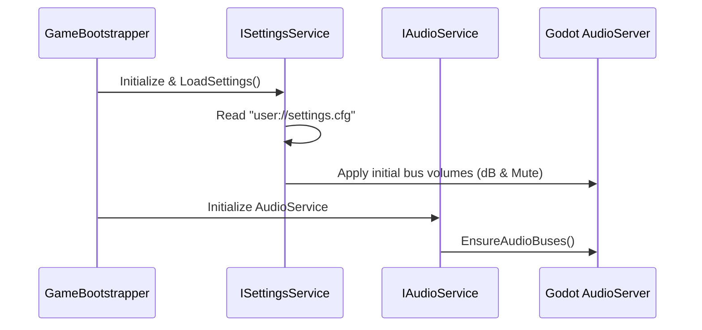

# Feature: Player Preferences & Settings Persistence (`ISettingsService`)

## 📖 Overview

A centralized system to manage and persist player preferences and presets across game sessions. This includes:
- **Audio Presets & Volume Levels:** Storing volume slider levels for all six audio buses (`Master`, `Music`, `SFX`, `Voice`, `Ambient`, `UI`).
- **Display & Graphics Settings:** Window mode (Fullscreen, Windowed, Borderless), display resolution, and VSync.
- **Controls & Key Remapping:** Custom key bindings overriding defaults defined in `project.godot`.
- **Gameplay Toggles:** Camera pan speed, subtitles, and gameplay preferences.

All preferences are persisted locally to a standard configuration file (`user://settings.cfg`) via `Godot.ConfigFile`. When IsoTactics launches, `ISettingsService` automatically restores all settings before any scenes or audio players initialize, guaranteeing that player audio levels and display modes take effect instantly without audio pops or visual glitches.

---

## 🎯 Goals & Use Cases

- **Goal 1 — Multi-Channel Audio Presets:** Automatically save and restore user volume preferences across all six audio channels (`Master`, `Music`, `SFX`, `Voice`, `Ambient`, `UI`).
- **Goal 2 — Non-Volatile Persistence:** Store settings in `user://settings.cfg` so player adjustments survive application restarts and version updates.
- **Goal 3 — Clean Architectural Service:** Implement `ISettingsService` as a singleton registered in `GameBootstrapper.cs` and resolved via `ServiceLocator.Provider`.
- **Goal 4 — Seamless UI Integration:** Two-way bind the volume sliders in `ScrOptionsController.cs` to `ISettingsService`, initializing slider thumbs to saved values and updating config upon release/change.
- **Goal 5 — Default Fallbacks & Reset:** Gracefully fall back to defaults if `user://settings.cfg` is missing or corrupted, and provide a single-click "Reset to Defaults" action in the Options menu.

### Use Cases

| Scenario | Expected Behavior |
|---|---|
| Player adjusts Music Volume to 40% and SFX Volume to 80% in the Options screen | Sliders update Godot audio buses in real time; values are serialized into `user://settings.cfg`. |
| Player closes and relaunches the game | `ISettingsService` loads `user://settings.cfg` on boot; audio buses and Options screen sliders initialize to 40% (Music) and 80% (SFX). |
| Player runs the game for the first time on a new system | No config file exists; `ISettingsService` creates `user://settings.cfg` with defaults (Master: 80%, Music: 70%, SFX: 100%, Voice: 90%, Ambient: 50%, UI: 60%). |
| Player presses "Reset to Defaults" in Options | Sliders and `AudioServer` buses reset to standard baseline; `user://settings.cfg` is rewritten with defaults. |
| Player remaps camera pan controls from WASD to Arrow Keys | Overridden key events are applied to `InputMap` on startup and persist across launches. |

---

## 👥 Target Audience / User Roles

- **Players:** Have full, persistent control over audio mix, key bindings, and display settings without needing to reconfigure on every launch.
- **Gameplay & UI Programmers:** Clean `ISettingsService` interface to query (`GetFloat`, `SetInt`, etc.) and subscribe to setting changes via events without dealing directly with filesystem I/O.
- **Audio Lead:** Guarantee that player mixing preferences are honored and never reset by scene transitions or audio bus self-healing.

---

## ⚙️ Functional Requirements

### 1. Audio Presets & Bus Persistence
- [ ] **REQ-SET-01:** Persist volume slider settings (0.0 to 100.0 scale, mapped to 0.0 to 1.0 linear) for all six audio buses:
  - `Master` (Default: 80.0)
  - `Music` (Default: 70.0)
  - `SFX` (Default: 100.0)
  - `Voice` (Default: 90.0)
  - `Ambient` (Default: 50.0)
  - `UI` (Default: 60.0)
- [ ] **REQ-SET-02:** When `ISettingsService` loads on game startup, apply loaded linear volume levels directly to `AudioServer.SetBusVolumeDb(busIndex, Mathf.LinearToDb(linear))` and `AudioServer.SetBusMute(busIndex, linear <= 0.001f)`.
- [ ] **REQ-SET-03:** Wire `ScrOptionsController.cs` to read initial slider positions from `ISettingsService` during `_Ready()`.
- [ ] **REQ-SET-04:** Wire slider value changes in `ScrOptionsController.cs` (`DragEnded` and navigation acceptance) to persist new values to `ISettingsService`.

### 2. Service Architecture & Contract
- [ ] **REQ-SET-05:** Define `ISettingsService` in `src/Core/Services/Contracts/ISettingsService.cs` exposing generic and typed getter/setter methods:
  - `float GetAudioVolume(string busName, float defaultLinear = 1.0f);`
  - `void SetAudioVolume(string busName, float linearVolume);`
  - `void SaveSettings();`
  - `void LoadSettings();`
  - `void ResetToDefaults();`
- [ ] **REQ-SET-06:** Implement `SettingsService` in `src/Core/Services/Implementations/SettingsService.cs`, adhering strictly to coding standards (regions, Allman style, explicit `this.`, `result` returns).
- [ ] **REQ-SET-07:** Register `ISettingsService` as a singleton in `GameBootstrapper.cs` and initialize it early in application boot.

### 3. Display, Controls & Future Presets
- [ ] **REQ-SET-08:** Store display parameters (`Fullscreen`, `VSync`, `Resolution`) under the `[Display]` section of `settings.cfg`.
- [ ] **REQ-SET-09:** Store customized key bindings under the `[Controls]` section of `settings.cfg`, applying overrides to `InputMap` on boot.
- [ ] **REQ-SET-10:** Provide atomic file writing (`ConfigFile.Save("user://settings.cfg")`) to prevent corrupted saves during unexpected shutdowns.

---

## 🎨 UI/UX Design & Interactions

### Options Screen Integration (`ScrOptions.tscn`)
- **Audio Tab:** 
  - Each `HSlider` initializes to the player's saved volume percentage.
  - Percentage labels (`80%`, `70%`, etc.) reflect loaded values immediately.
  - Real-time preview sound (`ui_click`) plays on the targeted bus when adjusting or releasing a slider.
- **Controls & Video Tabs:**
  - Future tabs in `ScrOptions.tscn` query `ISettingsService` for display mode and key bindings.
- **Action Buttons:**
  - "Apply" (saves current values to disk).
  - "Reset to Defaults" (resets all sliders and configuration to default template values).

---

## 💻 Technical Details

### 1. Configuration File Format (`user://settings.cfg`)

Godot's built-in `ConfigFile` provides human-readable INI-style serialization:

```ini
[Audio]
Master=0.80
Music=0.70
SFX=1.00
Voice=0.90
Ambient=0.50
UI=0.60

[Display]
WindowMode=0 ; 0 = Windowed, 1 = Fullscreen, 2 = Borderless
Resolution="1280x720"
VSync=true

[Controls]
camera_up="Key:W"
camera_down="Key:S"
camera_left="Key:A"
camera_right="Key:D"

[Gameplay]
SubtitlesEnabled=true
CameraPanSpeed=1.00
```

### 2. Service Interface (`ISettingsService.cs`)

```csharp
namespace Core
{
    /// <summary>
    /// Service responsible for storing, saving, and applying player preferences and hardware presets.
    /// </summary>
    public interface ISettingsService
    {
        /// <summary>
        /// Retrieves the linear volume level (0.0 to 1.0) for a specified audio bus.
        /// </summary>
        float GetAudioVolume(string busName, float defaultLinear = 1.0f);

        /// <summary>
        /// Updates and applies the linear volume level for a specified audio bus.
        /// </summary>
        void SetAudioVolume(string busName, float linearVolume);

        /// <summary>
        /// Serializes all current preferences to disk (user://settings.cfg).
        /// </summary>
        void SaveSettings();

        /// <summary>
        /// Reads and applies preferences from user://settings.cfg.
        /// </summary>
        void LoadSettings();

        /// <summary>
        /// Resets all settings to their project defaults and saves to disk.
        /// </summary>
        void ResetToDefaults();
    }
}
```

### 3. Startup Sequence & Bootstrapper Wiring



---

## 🧪 Testing Plan

- [ ] **First Boot Creation Test:** Delete `user://settings.cfg`, launch the game; verify `settings.cfg` is generated with default bus values.
- [ ] **Volume Persistence Test:** Set Music to 35% and SFX to 75% in Options, close the application, re-launch; verify sliders and Godot AudioServer buses load at 35% and 75%.
- [ ] **Mute Persistence Test:** Drag Master Volume slider to 0% (mute); restart application and verify Master bus remains completely muted with zero audio bleed.
- [ ] **Reset to Defaults Test:** Modify all sliders to 10%, click "Reset to Defaults"; verify sliders and buses return to project baseline (Master: 80%, Music: 70%, etc.).
- [ ] **Corrupted File Fallback Test:** Insert corrupted text into `user://settings.cfg`; verify game boots gracefully using fallback defaults without crashing.

---

## 🔗 Related Resources

- [`doc/features/ongoing/Audio-FX-Integration.md`](file:///d:/Data/OneDrive/12%20Areas/Ideas/IsoTactics/doc/features/ongoing/Audio-FX-Integration.md) — Connects volume sliders to Godot audio buses and implements REQ-VOL-01–05.
- [`doc/42 Game Services.md`](file:///d:/Data/OneDrive/12%20Areas/Ideas/IsoTactics/doc/42%20Game%20Services.md#L30-L32) — Architecture specification for `ISettingsService`.
- [`doc/43 Game Objects.md`](file:///d:/Data/OneDrive/12%20Areas/Ideas/IsoTactics/doc/43%20Game%20Objects.md#L702-L717) — `GameSettings` data model specification.
- [`doc/features/review/Save_System.md`](file:///d:/Data/OneDrive/12%20Areas/Ideas/IsoTactics/doc/features/review/Save_System.md) — Progress and campaign state persistence (separate from hardware presets).
