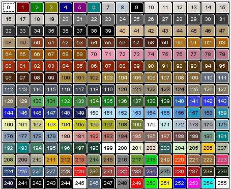

# Petz 4/5 Exact 256-Color Palette (`0`–`255`)

Auto-extracted from [`Petz_Workshop_Color_Chart.png`](Petz_Workshop_Color_Chart.png) (and matching [`src/resources/textures/petzpalette.png`](../../src/resources/textures/petzpalette.png)). See [Petz 256-Color Palette & 8-Bit Indexed `.bmp` Texture Format](Palettes-and-BMP-Textures.md) for how color ramps (`10`–`149`), fixed colors (`0`–`9`, `150`–`255`), and Z-depth shading work in the shaders.

| Index | Color Name | Hex Color |
| :--- | :--- | :--- |
| **0** | Unknown | `#FFFFFF` |
| **1** | Unknown | `#8A0A0A` |
| **2** | Green | `#0A8A0A` |
| **3** | Unknown | `#8A8A0A` |
| **4** | Unknown | `#0A0A8A` |
| **5** | Unknown | `#8A0A8A` |
| **6** | Aqua | `#0A8A8A` |
| **7** | Unknown | `#CACACA` |
| **8** | Unknown | `#CAD6E2` |
| **9** | Unknown | `#0A0A0A` |
| **10** | Unknown | `#F1ECE7` |
| **11** | Unknown | `#EDE8E2` |
| **12** | Unknown | `#E9E4DE` |
| **13** | Unknown | `#E5E0DA` |
| **14** | Unknown | `#E1DCD6` |
| **15** | White | `#DDD8D1` |
| **16** | Unknown | `#D9D4CD` |
| **17** | Unknown | `#D5D0C9` |
| **18** | White | `#D1CCC5` |
| **19** | White | `#CDC8C0` |
| **20** | Gray | `#7F7F7F` |
| **21** | Gray | `#797979` |
| **22** | Gray | `#747474` |
| **23** | Gray | `#6F6F6F` |
| **24** | Gray | `#6A6A6A` |
| **25** | Gray | `#656565` |
| **26** | Gray | `#606060` |
| **27** | Gray | `#5B5B5B` |
| **28** | Gray | `#565656` |
| **29** | Gray | `#505050` |
| **30** | (???) | `#4C4C4C` |
| **31** | Unknown | `#444444` |
| **32** | Unknown | `#3D3D3D` |
| **33** | Unknown | `#363636` |
| **34** | Unknown | `#2E2E2E` |
| **35** | Black | `#272727` |
| **36** | Black | `#202020` |
| **37** | Unknown | `#181818` |
| **38** | Unknown | `#111111` |
| **39** | Black | `#0A0A0A` |
| **40** | Unknown | `#E6CCA0` |
| **41** | Unknown | `#DFC59A` |
| **42** | Unknown | `#D9BF94` |
| **43** | Unknown | `#D2B98F` |
| **44** | Unknown | `#CCB389` |
| **45** | Cream | `#C5AC84` |
| **46** | Unknown | `#BFA67E` |
| **47** | Unknown | `#B8A079` |
| **48** | Unknown | `#B29A73` |
| **49** | Unknown | `#AC936D` |
| **50** | Cherry | `#914B2C` |
| **51** | Cherry | `#89472A` |
| **52** | Cherry | `#814328` |
| **53** | Cherry | `#7A3F26` |
| **54** | Cherry | `#723B24` |
| **55** | Cherry | `#6B3722` |
| **56** | Cherry | `#633320` |
| **57** | Cherry | `#5C2F1E` |
| **58** | Cherry | `#542B1C` |
| **59** | Cherry | `#4C271A` |
| **60** | Ginger | `#BE7D20` |
| **61** | Ginger | `#B9771D` |
| **62** | Ginger | `#B4721B` |
| **63** | Ginger | `#AF6D18` |
| **64** | Ginger | `#AB6816` |
| **65** | Ginger | `#A66213` |
| **66** | Ginger | `#A15D11` |
| **67** | Ginger | `#9D580E` |
| **68** | Ginger | `#98530C` |
| **69** | Ginger | `#934E0A` |
| **70** | Unknown | `#FAA8C1` |
| **71** | Unknown | `#F3A3BC` |
| **72** | Unknown | `#ED9FB7` |
| **73** | Unknown | `#E79BB2` |
| **74** | Unknown | `#E097AD` |
| **75** | Pink | `#DA92A8` |
| **76** | Unknown | `#D48EA3` |
| **77** | Unknown | `#CD8A9E` |
| **78** | Unknown | `#C78699` |
| **79** | Unknown | `#C18195` |
| **80** | Unknown | `#B2330B` |
| **81** | Unknown | `#AE320B` |
| **82** | Unknown | `#A9310B` |
| **83** | Unknown | `#A5300B` |
| **84** | Unknown | `#A12F0B` |
| **85** | Unknown | `#9C2E0B` |
| **86** | Unknown | `#982D0B` |
| **87** | Unknown | `#942C0B` |
| **88** | Unknown | `#8F2B0B` |
| **89** | Unknown | `#8B2A0B` |
| **90** | Brown | `#755416` |
| **91** | Brown | `#6F4E15` |
| **92** | Brown | `#6A4815` |
| **93** | Brown | `#654315` |
| **94** | Brown | `#603D15` |
| **95** | Brown | `#5B3714` |
| **96** | Brown | `#563114` |
| **97** | Brown | `#512C14` |
| **98** | Brown | `#4C2614` |
| **99** | Brown | `#462013` |
| **100** | Sandy | `#B09442` |
| **101** | Sandy | `#AC8F41` |
| **102** | Sandy | `#A88B41` |
| **103** | Sandy | `#A48741` |
| **104** | Sandy | `#A08240` |
| **105** | Sandy | `#9D7E40` |
| **106** | Sandy | `#997A40` |
| **107** | Sandy | `#95753F` |
| **108** | Sandy | `#91713F` |
| **109** | Sandy | `#8E6C3F` |
| **110** | Steel | `#6C7A87` |
| **111** | Steel | `#677380` |
| **112** | Steel | `#626D7A` |
| **113** | Steel | `#5D6773` |
| **114** | Steel | `#58616D` |
| **115** | Steel | `#535A67` |
| **116** | Steel | `#4E5460` |
| **117** | Steel | `#494E5A` |
| **118** | Steel | `#444854` |
| **119** | Steel | `#40424D` |
| **120** | Dusty | `#A4987D` |
| **121** | Dusty | `#A0947A` |
| **122** | Dusty | `#9D9177` |
| **123** | Dusty | `#9A8E75` |
| **124** | Dusty | `#968B72` |
| **125** | Dusty | `#938870` |
| **126** | Dusty | `#90856D` |
| **127** | Dusty | `#8C826B` |
| **128** | Dusty | `#897F68` |
| **129** | Dusty | `#867B65` |
| **130** | Green | `#5FB561` |
| **131** | Green | `#46AB51` |
| **132** | Green | `#1FA321` |
| **133** | Green | `#3F8D40` |
| **134** | Green | `#3A8526` |
| **135** | Green | `#1A8323` |
| **136** | Green | `#316C21` |
| **137** | Green | `#396835` |
| **138** | Green | `#1D661E` |
| **139** | Green | `#1A4B1B` |
| **140** | Unknown | `#356BCD` |
| **141** | Unknown | `#4250ED` |
| **142** | Unknown | `#3D45FF` |
| **143** | Unknown | `#3D4DD8` |
| **144** | Unknown | `#2024E1` |
| **145** | Unknown | `#3846C0` |
| **146** | Unknown | `#2026B3` |
| **147** | Unknown | `#344C9A` |
| **148** | Unknown | `#232C81` |
| **149** | Unknown | `#1B235D` |
| **150** | Unknown | `#E2FAFF` |
| **151** | Unknown | `#B6EAFF` |
| **152** | Unknown | `#A3E0FF` |
| **153** | Unknown | `#8CD4FF` |
| **154** | Unknown | `#7FC0F2` |
| **155** | Unknown | `#72CAFF` |
| **156** | Unknown | `#5BA0E6` |
| **157** | Unknown | `#22A6D8` |
| **158** | Unknown | `#6095C3` |
| **159** | Unknown | `#2893B3` |
| **160** | Unknown | `#F5F7B1` |
| **161** | Unknown | `#F4F59A` |
| **162** | Unknown | `#DBD681` |
| **163** | Unknown | `#FFFE0A` |
| **164** | Unknown | `#F7F23C` |
| **165** | Unknown | `#CDCE15` |
| **166** | Unknown | `#CDCD3E` |
| **167** | Unknown | `#A9AC21` |
| **168** | Unknown | `#A9A94D` |
| **169** | Unknown | `#788438` |
| **170** | Unknown | `#FFFFFF` |
| **171** | Blue | `#CAEEF1` |
| **172** | Blue | `#B6D0DF` |
| **173** | Blue | `#B1B1BB` |
| **174** | Blue | `#AAAAB2` |
| **175** | Blue | `#7EAAC0` |
| **176** | Blue | `#8DA3BB` |
| **177** | Blue | `#8DA3BB` |
| **178** | Blue | `#8AA2BA` |
| **179** | Unknown | `#8AA2BA` |
| **180** | Unknown | `#ECC8B6` |
| **181** | Unknown | `#DF9D9A` |
| **182** | Unknown | `#E18078` |
| **183** | Unknown | `#C27D71` |
| **184** | Unknown | `#A9817D` |
| **185** | Unknown | `#AC7467` |
| **186** | Unknown | `#936E62` |
| **187** | Unknown | `#A26157` |
| **188** | Unknown | `#744F4C` |
| **189** | Unknown | `#64463B` |
| **190** | Unknown | `#7CA896` |
| **191** | Unknown | `#0A8A8A` |
| **192** | Unknown | `#4C847F` |
| **193** | Unknown | `#0A8A8A` |
| **194** | Unknown | `#43826A` |
| **195** | Unknown | `#47646D` |
| **196** | Unknown | `#306251` |
| **197** | Unknown | `#2B4B35` |
| **198** | Unknown | `#1C433A` |
| **199** | Unknown | `#FFFFFF` |
| **200** | Unknown | `#FFFFFF` |
| **201** | Unknown | `#FEFFE2` |
| **202** | Unknown | `#F3E2CC` |
| **203** | Dark Aqua | `#366963` |
| **204** | Unknown | `#DDFECF` |
| **205** | Unknown | `#CEDDA9` |
| **206** | Unknown | `#FFD124` |
| **207** | Unknown | `#BAC2A5` |
| **208** | Unknown | `#B9BB81` |
| **209** | Unknown | `#AF9E98` |
| **210** | Unknown | `#B6B399` |
| **211** | Unknown | `#E1AA1E` |
| **212** | Unknown | `#D08912` |
| **213** | Unknown | `#D47850` |
| **214** | Unknown | `#83986B` |
| **215** | Unknown | `#A38857` |
| **216** | Unknown | `#8A8A8A` |
| **217** | Unknown | `#6FA534` |
| **218** | Unknown | `#0AD520` |
| **219** | Unknown | `#B17643` |
| **220** | Unknown | `#FF4C0A` |
| **221** | Unknown | `#A16E4C` |
| **222** | Unknown | `#A36F34` |
| **223** | Unknown | `#E73E74` |
| **224** | Unknown | `#334E7F` |
| **225** | Unknown | `#6273BF` |
| **226** | Unknown | `#4C758E` |
| **227** | Unknown | `#5A6E8A` |
| **228** | Unknown | `#7F6354` |
| **229** | Unknown | `#FF221E` |
| **230** | Unknown | `#786635` |
| **231** | Unknown | `#A64C43` |
| **232** | Unknown | `#C23C4C` |
| **233** | Unknown | `#924E4C` |
| **234** | Unknown | `#5F4E89` |
| **235** | Unknown | `#889690` |
| **236** | Unknown | `#D91A16` |
| **237** | Unknown | `#9C231E` |
| **238** | Unknown | `#3D391C` |
| **239** | Unknown | `#1B3218` |
| **240** | Unknown | `#171A33` |
| **241** | Unknown | `#0A0A0A` |
| **242** | Unknown | `#0A0A0A` |
| **243** | Unknown | `#0A0A0A` |
| **244** | Black | `#0A0A0A` |
| **245** | Unknown | `#FFFFFF` |
| **246** | Unknown | `#5A6E8A` |
| **247** | Unknown | `#0A0A0A` |
| **248** | Unknown | `#8A8A8A` |
| **249** | Unknown | `#FF0A0A` |
| **250** | Unknown | `#0AFF0A` |
| **251** | Unknown | `#FFFF0A` |
| **252** | Unknown | `#0A0AFF` |
| **253** | Unknown | `#FF0AFF` |
| **254** | Unknown | `#0AFFFF` |
| **255** | Unknown | `#FFFFFF` |
